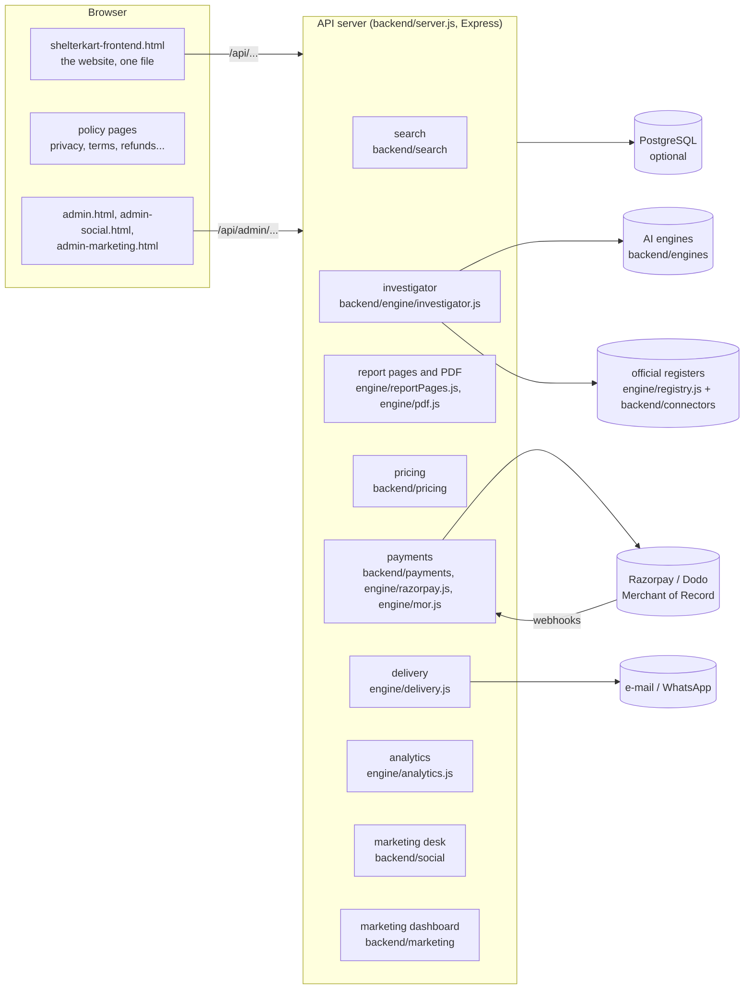

# ShelterKart: developer guide

For a developer who must change or fix ShelterKart by hand. It explains how the website works, where each piece of code lives,
and how to make the common changes safely. Written 31 October 2026 from the code itself; when the code and this guide disagree,
the code is right and this guide should be corrected.

Other documents worth knowing: `LAUNCH.md` (going live, step by step), `CONSTITUTION.md` (the rules the product must obey),
`SEARCH.md` (the search), `SOCIAL_ENGINE.md` (the marketing desk and dashboard), `KEEPER_FIRST_RUN.md` (the knowledge keeper),
`LATEST.md` (release notes, newest first).

---

## 1. The system in one picture



**Two separate deployments.** The website files (the `.html` pages at the top of the project) are static and can be hosted
anywhere. The API server in `backend/` is a Node.js process. The website finds the server through one line near the top of
`shelterkart-frontend.html`:

```js
const API_BASE = "";   // empty = demo mode (illustrative records, no server); set to "https://api.your-domain.com" to go live
```

`admin.html` has the same line. With `API_BASE` empty the site runs as a self-contained demo.

**Storage is optional.** With `DATABASE_URL` set, research, purchases, analytics, replies and the marketing desk live in
PostgreSQL. Without it, most of them fall back to memory or to files (see section 6), which is fine for a demo and wrong for
production.

---

## 2. Folders and files

```
/                                   the website (static) and the project's documents
├── shelterkart-frontend.html       THE website: home, search, demo, results, payment screens, footer windows. One file.
├── about.html, contact.html, corrections.html, delivery.html, evidence.html, independence.html,
│   methodology.html, pricing.html, privacy.html, refunds.html, terms.html
│                                   standalone policy and information pages, GENERATED from the website by
│                                   tools/build_policies.js: edit the website, not these
├── admin.html                      the operator's dashboard (reports, held findings, disputes, costs, health)
├── backend/social/admin-social.html  the marketing desk screen (served by the API at /admin/social)
├── backend/marketing/admin-marketing.html  the marketing dashboard screen (served by the API at /admin/marketing)
├── sw.js, manifest.json            the installable-app shell (service worker, app manifest)
├── i18n/                           interface translations: en.json lists every string, one file per language
├── legal/                          the legal pack (Final is current; v2 is kept for history)
├── guide/                          the free Home Buying Guide: content and build scripts
├── brand/, logo/, icons/           brand tokens, fonts, logos, app icons
├── sample-reports/                 the reference reports as HTML and PDF
├── deck/                           the investor deck: model/ (numbers), builder, renderer, every version kept
├── versions/                       earlier website versions. ShelterKart-Frontend-V1.html is FROZEN: never edit it.
├── ops/                            backup.sh and restore_drill.sh for the database
├── tools/                          build scripts, checks and browser tests (section 8)
├── _archive_do_not_publish/        old material that must never be published
└── backend/                        the API server
    ├── server.js                   every route, wired together (start here)
    ├── *.sql                       database migrations (only 12 run: see section 6)
    ├── .env.example                every setting, documented (copy to .env)
    ├── engine/                     the product: research, investigator, reports, access, languages, markets...
    ├── engines/                    the AI vendors behind one interface (Anthropic, OpenAI, Gemini, xAI, DeepSeek)
    ├── connectors/                 safe fetching of official registers (egress guard, framework, untrusted documents)
    ├── pricing/                    who the buyer is, quotes, price books, invoices, tax ledger
    ├── payments/                   the provider-neutral payment layer and refunds
    ├── search/                     the new search: reading queries, the project index, candidates, the shadow
    ├── social/                     the marketing desk: plan, check, approve, publish, knowledge keeper
    ├── marketing/                  the marketing dashboard: weekly numbers, early warnings, decision rules
    ├── data/                       reference data: markets, playbooks, registers, price books, AI engines, samples
    └── test/                       the test suites (section 8)
```

### The `backend/engine/` modules

| File | What it does |
| --- | --- |
| `research.js` | The research engine: validates a query, reuses a known project, or runs research; keeps briefs by reference |
| `investigator.js` | The investigator: the live, multi-step investigation behind the default flow |
| `dossier.js`, `dossierBrief.js`, `dossierHtml.js` | The investigation's results, as a sellable brief and as an HTML/print document |
| `reportPages.js` | Server-rendered pages a buyer moves through (`/start`, `/r/:ref`) |
| `pdf.js` | The report as a PDF, printed by headless Chromium (Playwright) |
| `access.js` | Who may read a paid report: preview vs full, signed access tokens |
| `searchLane.js`, `grounding.js` | Web search for research, and marking which sources are official |
| `registry.js`, `registryHttp.js` | Official-register connectors and their single HTTP client |
| `entities.js` | Remembers which typed names and registration numbers point to which researched project |
| `markets.js`, `languages.js` | The markets and languages: one source of truth each |
| `protections.js` | "Your protections as a buyer" in a report |
| `documents.js` | The buyer's own documents (the document check) |
| `review.js`, `reviews.js`, `responses.js` | Adverse findings held for a person; disputes; replies and corrections |
| `delivery.js` | E-mail and WhatsApp delivery of a report |
| `razorpay.js`, `mor.js` | Razorpay (India) and the Merchant of Record (Dodo) adapters |
| `analytics.js` | First-party visit statistics, the visit-source consent rule |
| `botguard.js` | Proof-of-work before an expensive new investigation |
| `persistence.js`, `jobStore.js`, `jobCosts.js` | Saving research; saving running investigations to disk; what each costs |
| `health.js`, `credits.js`, `translate.js`, `adviser.js` | Source health; register credits; translating a report; the adviser |

---

## 3. The buyer's journey

The default flow is the **investigator** (`REPORT_FLOW = "investigator"` in `shelterkart-frontend.html`).

```mermaid
flowchart TD
  H[Home: country grid, then the search box<br/>shelterkart-frontend.html] --> Q{SEARCH_V2}
  Q -- shadow / off --> INV
  Q -- on --> C["POST /api/search/candidates<br/>backend/search"] --> CH[Buyer picks a project<br/>or 'tell us what you remember'<br/>or 'research anyway'] --> INV
  INV["POST /api/investigate<br/>limits, bot guard, caps<br/>server.js"] --> J[Live job: free preview sweep<br/>engine/investigator.js]
  J --> EV["GET /api/investigate/:ref/events<br/>progress as it happens"]
  J --> PG["/r/:ref: the preview page<br/>engine/reportPages.js"]
  PG --> QT["POST /api/research/quote<br/>backend/pricing"] --> CO["POST /api/research/checkout<br/>Razorpay order or Merchant of Record"]
  CO --> WH["Webhook: /api/payments/razorpay/webhook<br/>or /api/payments/mor/webhook<br/>markPurchasePaid() in server.js"]
  WH --> FULL[Full investigation completes<br/>completeLive() in server.js]
  FULL --> RP["/r/:ref full report, /r/:ref/pdf<br/>access token: engine/access.js"]
  FULL --> DL[E-mail and WhatsApp with the link<br/>engine/delivery.js]
```

| Step | What the buyer sees | Route | Code |
| --- | --- | --- | --- |
| 1 | Home: flags of 36 markets, then the search box | (static) | `shelterkart-frontend.html` |
| 2 | Optional: candidates to choose from (only when `SEARCH_V2=on`) | `POST /api/search/candidates` | `backend/search/` |
| 3 | "Starting the investigation" | `POST /api/investigate` | `server.js` (route), `engine/investigator.js` |
| 4 | Live progress, then the free preview | `GET /api/investigate/:ref/events`, `GET /r/:ref` | `server.js`, `engine/reportPages.js` |
| 5 | A price for their country and currency | `POST /api/research/quote` | `backend/pricing/` |
| 6 | Payment | `POST /api/research/checkout`, then the provider's page | `server.js`, `backend/payments/`, `engine/razorpay.js`, `engine/mor.js` |
| 7 | Payment confirmed (often seconds later, by webhook) | `POST /api/payments/*/webhook` | `markPurchasePaid()` in `server.js` |
| 8 | The full report, its PDF, and the link by e-mail/WhatsApp | `GET /r/:ref`, `GET /r/:ref/pdf` | `engine/access.js`, `engine/pdf.js`, `engine/delivery.js` |
| 9 | Lost the link | `POST /api/research/recover` | `server.js` |

**The older research route** (`POST /api/research`, `engine/research.js`) is still used by the document check and by tests; new
searches go through the investigator. **Both** feed the search's shadow comparison and its project index.

**What a visit records** (no cookies, no IP stored): `POST /api/track` writes first-party events (`engine/analytics.js`). The
visit's source (campaign link or referrer) is kept in the tab's session storage and sent with checkout so a paid report can be
traced to its channel; in the EEA, UK and Switzerland only after the visitor says yes (`GET /api/source-consent`).

---

## 4. The operator's side

| Screen | Address | What it is for | Code |
| --- | --- | --- | --- |
| Admin | `admin.html` (set its `API_BASE`) | Reports, held findings, disputes, replies, refunds, costs, engines, source health, tax | `/api/admin/*` in `server.js` |
| Marketing desk | `/admin/social` | Plan, check and approve a week of posts; pauses; the knowledge keeper | `backend/social/` |
| Marketing dashboard | `/admin/marketing` | The weekly numbers per market, early warnings, decision rules, inputs | `backend/marketing/` |
| Search shadow | `GET /api/admin/search/shadow` (JSON) | How the new search compares with the old on real searches | `backend/search/service.js` |

Every `/api/admin/*` route and both admin screens require the admin login (`ADMIN_USERNAME`, `ADMIN_PASSWORD`).

**Held findings.** An adverse finding in a market listed in `ADVERSE_HOLD_MARKETS` waits for a person: `GET /api/admin/held`,
then `POST /api/admin/held/:ref/approve`. **Replies and corrections** arrive through `POST /api/responses` and are handled under
`/api/admin/responses`. **Refunds**: `POST /api/admin/refunds` (`backend/payments/refunds.js`).

---

## 5. All routes, grouped

| Group | Routes |
| --- | --- |
| Site and pages | `/start`, `/r/:ref`, `/r/:ref/pdf`, `/samples/:id`, `/samples/:id/pdf`, `/guide`, `/guide/pdf`, `/guide/card.png`, `/guide/card.pdf`, `/robots.txt`, `/sitemap.xml`, `/assets/report-live.js` |
| Reference | `GET /api/health`, `/api/markets`, `/api/languages`, `/api/pricing/countries`, `/api/source-consent`, `/api/search/config` |
| Search | `POST /api/search/candidates` |
| Investigate | `POST /api/investigate`, `GET /api/investigate/:ref/events`, `POST /api/investigate/:ref/contact` |
| Research | `POST /api/research`, `GET /api/research/challenge`, `GET /api/research/by-ref/:ref`, `POST /api/research/document-check` |
| Buying | `POST /api/research/quote`, `/checkout`, `/razorpay/verify`, `/access`, `/recover` |
| Payment webhooks | `POST /api/payments/razorpay/webhook`, `/api/payments/mor/webhook`, `/api/payments/webhook` |
| Replies, disputes | `POST /api/responses`, `/api/responses/confirm`, `GET /api/responses/:reportRef`, `/api/responses/status/:publicRef`, `POST /api/developer-response`, `GET /api/developer-response/:reportRef`, `POST /api/dispute` |
| Analytics | `POST /api/track` |
| Admin | everything under `/api/admin/` (reports, held, disputes, responses, refunds, costs, engines, source health, stats, tax, purge, investigate, social, marketing, search) |
| Marketing desk | `/admin/social`, `/api/admin/social/*`, `/api/social/telegram/webhook`, `/social-media/:file` |
| Marketing dashboard | `/admin/marketing`, `/api/admin/marketing/*` |

To find any route's code: search `server.js` (or `social/index.js`, `marketing/index.js`, `search/service.js`) for the path.

---

## 6. Where data is kept

**PostgreSQL** (when `DATABASE_URL` is set). Tables are created by migrations, run in this order by `node tools/migrate.js`:

1. `schema.sql` 2. `schema_evidence.sql` 3. `razorpay_orders.sql` 4. `idempotent_checkout.sql` 5. `research_persistence.sql`
6. `source_health.sql` 7. `analytics.sql` 8. `translations.sql` 9. `pricing_v2.sql` 10. `responses.sql` 11. `social.sql`
12. `purchase_attribution.sql`

The other 13 `.sql` files in `backend/` are **older files that are never run**; do not apply them. Each migration runs once, in its
own transaction, and is recorded with a checksum: **never edit an applied migration**; write a new one (recipe in section 9).

**Files and memory** (used when there is no database, or by design):

| What | Where | Setting |
| --- | --- | --- |
| Running investigations | one JSON file per report | `LIVE_JOBS_DIR` (default `backend/data/live-jobs`) |
| Marketing desk and dashboard inputs | files, or the `social_docs` table | `SOCIAL_DATA_DIR` / database |
| Search index | `search-index.json` | `SEARCH_DATA_DIR` (or `SOCIAL_DATA_DIR`) |
| Price book | a file, or the database with `PRICING_STORE=pg` | `PRICING_STORE` |
| Reference data | `backend/data/*.json` | (committed files) |

Backups: `ops/backup.sh`; test a restore with `ops/restore_drill.sh`.

---

## 7. Settings

Every setting is in `backend/.env.example`, with comments. Copy it to `backend/.env` and fill in. The groups:

| Group | Settings (examples) |
| --- | --- |
| Server | `PORT`, `NODE_ENV`, `ALLOWED_ORIGINS`, `PUBLIC_BASE_URL`, `DATABASE_URL` |
| Admin | `ADMIN_USERNAME`, `ADMIN_PASSWORD`, `ALERT_WEBHOOK_URL` |
| AI engines | `ANTHROPIC_API_KEY`, `OPENAI_API_KEY`, `GEMINI_API_KEY`, `XAI_API_KEY`, `DEEPSEEK_API_KEY`, `*_MODEL`, `AI_ENGINES`, `AI_ROUTING`, `AI_DAILY_MAX_USD` |
| Research limits | `RESEARCH_PAUSED`, `RESEARCH_DAILY_CAP`, `RESEARCH_HOURLY_PER_IP`, `INVESTIGATE_DAILY_CAP`, `INVESTIGATE_MARKET_DAILY_CAP`, `INVESTIGATE_CONCURRENCY`, `BOT_GUARD` |
| Registers | `COMPANIES_HOUSE_API_KEY`, `ABR_GUID`, `SOURCE_HEALTH_SCHEDULE` |
| Payments and tax | `PAYMENTS_ENABLED`, `RAZORPAY_KEY_ID`, `RAZORPAY_KEY_SECRET`, `RAZORPAY_WEBHOOK_SECRET`, `DODO_API_KEY`, `DODO_WEBHOOK_KEY`, `GSTIN`, `LUT_NO`, `BUSINESS_LEGAL_NAME`, `QUOTE_SECRET`, `ACCESS_TOKEN_SECRET` |
| Delivery | `DELIVERY_EMAIL_PROVIDER`, `RESEND_API_KEY` or `POSTMARK_SERVER_TOKEN`, `WHATSAPP_TOKEN`, `WHATSAPP_PHONE_ID`, `WHATSAPP_TEMPLATE` |
| Review and safety | `ADVERSE_HOLD_MARKETS`, `RESPONSIBLE_NAME`, `CORRECTIONS_EMAIL` |
| Translation | `TRANSLATE_ENABLED`, `TRANSLATE_VERIFY`, `TRANSLATE_DAILY_CAP` |
| Search and consent | `SEARCH_V2` (`shadow` default, `on`, `off`), `SEARCH_DATA_DIR`, `SK_SOURCE_CONSENT` (`eu` default, `all`, `none`) |
| Marketing desk | `SOCIAL_*` settings (documented in `SOCIAL_ENGINE.md`) |

Secrets go only in `.env` on the server, never in the website files or in the repository.

---

## 8. Running and testing

**Run locally**

```bash
cd backend
npm install
cp .env.example .env          # then fill in what you need; nothing is required for a first run
npm run dev                   # node --watch server.js
```

Open `shelterkart-frontend.html` in a browser. To talk to your local server, set `API_BASE` to `http://localhost:4000`
(the default `PORT`). With a database: `DATABASE_URL=postgres://... node ../tools/migrate.js --dry-run`, then without `--dry-run`.

**Test**

```bash
cd backend
npm test                                  # every suite in order; stops at the first failure
node test/search/search.test.js           # any one suite on its own
node -r ./test/harness/stub-loader.js test/harness/payments.test.js   # harness suites need the stub loader
python3 ../tools/count_checks.py          # all suites, with the total the investor deck quotes
```

The tests run without network access or real keys: AI engines, registers, payments and the database are replaced by stand-ins.

| Folder | What it tests |
| --- | --- |
| `test/*.test.js` | Engine, pricing, AI engines, ops (migrations), site, policies, i18n, PDF, tiers, tools, MoR, responses, admin |
| `test/harness/` | The real server with stand-ins for its outside services: payments, buyer journey, analytics, Razorpay, review, scale... |
| `test/social/` | The marketing desk: schedule, checker, lexicons, desk, cards, publishers, keeper, seeds, routes |
| `test/marketing/` | The marketing dashboard's rules and routes |
| `test/search/` | The search: reading, hints, the index, 37 messy test queries, the service |

**Browser checks** (need Playwright and Chromium; run by hand, not part of `npm test` unless listed in `count_checks.py`):
`tools/ui_smoke.py` (the whole site), `tools/readability_sweep.py`, `tools/search_ui_check.py`, `tools/source_consent_check.py`,
`tools/social_ui_check.py`, `tools/voice_test.py`, `tools/demo_search_test.py`, `tools/search_readability.py`.

**Before every release:** `npm test` passes, `python3 tools/count_checks.py` shows no failing suite, and `tools/ui_smoke.py` passes.

---

## 9. How to make common changes

**Change a word the visitor sees (any of the nine languages)**
1. Change the English text in `shelterkart-frontend.html` (inside `data-i18n` elements or `xlate('...')` / `tx('...')` calls).
2. Rename the same key in `i18n/en.json` and in every `i18n/<language>.json`, with the new translation.
3. Run `node tools/build_i18n.js`, then `node tools/build_i18n.js --check`, then `node backend/test/i18n.test.js`.
The English text is the key: if one file is missed, the test names it.

**Change the privacy policy, terms or another policy**
The policy text has one source: the footer windows of `shelterkart-frontend.html`. The standalone pages (`privacy.html`,
`terms.html`, `refunds.html` and the others) are generated from it: edit the website, then run `node tools/build_policies.js`,
then `node backend/test/policies.test.js`, which checks the pages were copied from the site. Mirror legal changes in
`legal/ShelterKart-Final-Legal-Pack.md` and have them reviewed by counsel.

**Change a price**
Prices live in versioned price books in `backend/data/`. Generate the next one with `node tools/build_price_book.js` (it refuses
books that break the guardrails), then `node tools/seed_pricing.js` for the database. Never edit a released price book by hand.

**Add or change an AI engine**
Adapters are in `backend/engines/`; the catalogue (models, prices) is `backend/data/ai-engines.json`. An engine serves buyers only
after `node tools/engine_benchmark.js` passes for it. Choose engines with `AI_ENGINES` and `AI_ROUTING`.

**Add an official-register connector**
Add it to `engine/registry.js`; all fetching must go through `engine/registryHttp.js` and `connectors/egress.js` (they block
unsafe addresses). Add the register to `backend/data/registers.json` with its licence terms.

**Fix something in a report**
The report's content comes from `engine/investigator.js` and `engine/dossier*.js`; its page from `engine/reportPages.js` and
`engine/dossierHtml.js`; its PDF from `engine/pdf.js`. Reproduce the bug in a test under `test/` first, then fix it.

**Improve the search**
Spelling and scripts: `search/normalize.js`. Hint words: `search/hints.js`. Scoring and confidence: `search/index.js`. Add the
failing query to `test/search/golden.js` with what it should return, fix, and run `node test/search/search.test.js`: the rule is
"never confidently wrong". Load real projects with `POST /api/admin/search/projects` (format in `backend/data/search/README.md`).

**Change a database table**
Never edit an applied `.sql` file. Write a new migration in `backend/`, add its name at the end of the `MIGRATIONS` list in
`tools/migrate.js`, update the expected list and counts in `test/ops.test.js`, and run `node tools/migrate.js --dry-run`.

**Change a marketing-desk rule**
The rules every post must pass are in `social/checker.js`; banned words per language in `social/data/lexicons.json`. Run
`node test/social/checker.test.js` (it includes 270 deliberately bad posts that must all be stopped).

**Add a market**
Markets are defined once in `engine/markets.js`; the playbooks in `backend/data/playbooks.json`; countries and currencies in
`backend/data/countries.json` and `currencies.json`. Check `node tools/market_readiness.js` afterwards.

**Rebuild the investor deck after a change in the test count**
`cd deck/model && python3 market_model.py && python3 markets_added.py && python3 investor_v2.py && python3 pnl.py && cd .. &&
python3 build_deck_v2.py && python3 render_v2.py && python3 check_deck_v2.py`, then copy `ShelterKart-Investor-Deck-v2.pdf` to a
new version name. Keep every earlier version.

---

## 10. When something goes wrong

| Symptom | Look at |
| --- | --- |
| The site shows sample reports only | `API_BASE` is empty in `shelterkart-frontend.html` |
| Searches stop working | `GET /api/health`; `RESEARCH_PAUSED`; the daily caps (`*_DAILY_CAP`); `AI_DAILY_MAX_USD`; the engines at `GET /api/admin/engines` |
| A payment went through but the report did not open | The webhook secret (`RAZORPAY_WEBHOOK_SECRET` / `DODO_WEBHOOK_KEY`); the purchase row in `report_purchases`; `markPurchasePaid()` in `server.js` |
| Report e-mails or WhatsApp messages not sent | `GET /api/admin/delivery`; the delivery keys; `engine/delivery.js` |
| PDFs fail | Playwright and Chromium installed on the server; `PDF_CONCURRENCY`; `engine/pdf.js` |
| `migrate.js` stops with "changed after being applied" | Someone edited an applied migration: restore it and write a new one |
| A register shows as failing | `GET /api/admin/source-health`; run `node backend/source_health_cli.js` |
| Costs are higher than expected | `GET /api/admin/costs` and `GET /api/admin/engines` |
| The marketing desk will not publish | `GET /api/admin/social/status`: pauses, circuit breakers and missing approvals are listed |

The server writes its own errors to standard output with a `[area]` prefix (for example `[checkout]`, `[search]`, `[social]`).

---

## 11. Rules that must not be broken

From `CONSTITUTION.md` and the founder's standing instructions:

- **No scores and no verdicts.** A report states facts and questions with their sources; it never rates a project or a developer, and nothing a developer pays can change what is shown or how search ranks it.
- **Anyone can buy any report at the same price.** No money influences the research.
- **The first screen (country grid, then the search) and the gold hero are not changed without the founder's approval.**
- **Readability comes first:** every visible text, in every state and language, at least 14 px on a phone, controls at least 44 px tall.
- **Keep earlier versions** (website, deck, legal) alongside new ones; never delete without asking. `versions/ShelterKart-Frontend-V1.html` is frozen.
- **Policy texts have one source**, the website; the standalone pages are generated from it (`tools/build_policies.js`).
- **Secrets never enter the repository** or the website files.

---

## 12. Words used in the code

| Word | Meaning |
| --- | --- |
| brief | The data of one report, by its reference (`ref`, like `SK-AB12`) |
| ref | A report's public reference |
| investigator, sweep | The live investigation; the sweep is its first, free pass that produces the preview |
| dossier | The investigation's collected findings |
| preview / full | What anyone may see vs what a paid report shows |
| held | An adverse finding waiting for a person to check it |
| playbook | Per-country guidance: where to look, which buyer protections apply, what to check |
| knowledge item, keeper | A verified fact the marketing desk may restate; the agent that drafts them from official pages |
| shadow | Running new code silently beside the old and keeping the comparison, before it is switched on |
| MoR | Merchant of Record (Dodo), which sells on ShelterKart's behalf outside India |
