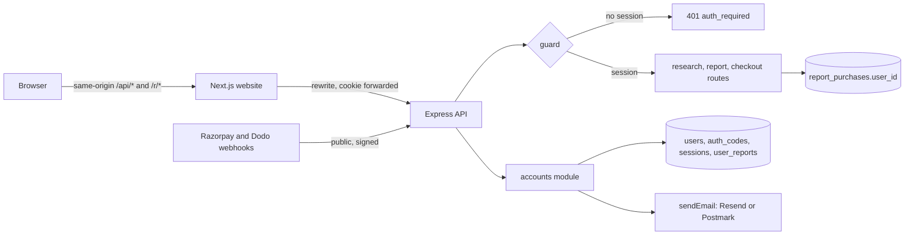
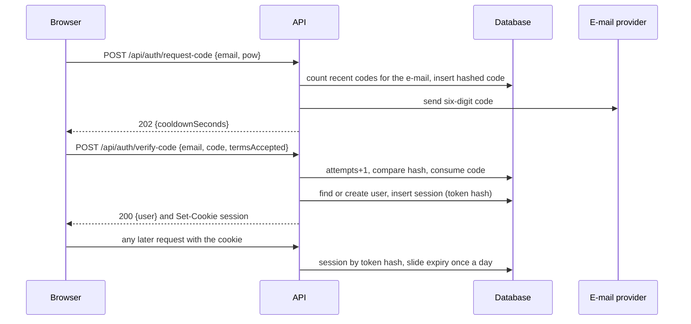

# User accounts and sign-in: technical design

Status: draft, written 3 November 2026 against `main` plus PR #11. Read `PRD.md` first. The HTTP contract is `docs/api/openapi.yaml` (tag Accounts). The website side is in `FRONTEND-CONTRACT.md`; the build order and tests are in `IMPLEMENTATION-PLAN.md`.

## 1. Principles

1. One switch, `ACCOUNTS_ENABLED`. Off means today's behaviour, byte for byte, on every existing route.
2. No new npm dependency. Cookies are parsed by hand, random values come from `crypto`, e-mail goes through the existing `sendEmail`.
3. Opaque server-side sessions, not JWTs: a session can be revoked at once.
4. Secrets (codes, session tokens) are stored only as hashes and never logged.
5. Every outside thing is passed in (database, e-mail, clock, audit), as `engine/responses.js` does, so the logic is testable without a server.
6. A route is either public or behind one guard. There is no third state.

## 2. Architecture





## 3. Data model

New migration `backend/accounts.sql`, added as the thirteenth entry of `MIGRATIONS` in `tools/migrate.js`. It is additive and idempotent.

```sql
CREATE TABLE IF NOT EXISTS users (
  id                UUID PRIMARY KEY DEFAULT uuid_generate_v4(),
  email             TEXT NOT NULL,
  email_verified_at TIMESTAMPTZ,
  display_name      TEXT,
  country           TEXT,
  language          TEXT,
  phone             TEXT,
  phone_consent_at  TIMESTAMPTZ,
  terms_version     TEXT,
  privacy_version   TEXT,
  terms_accepted_at TIMESTAMPTZ,
  created_at        TIMESTAMPTZ NOT NULL DEFAULT now(),
  last_login_at     TIMESTAMPTZ,
  disabled_at       TIMESTAMPTZ,
  deleted_at        TIMESTAMPTZ
);
CREATE UNIQUE INDEX IF NOT EXISTS uq_users_email_live ON users (lower(email)) WHERE deleted_at IS NULL;

CREATE TABLE IF NOT EXISTS auth_codes (
  id          UUID PRIMARY KEY DEFAULT uuid_generate_v4(),
  email_lower TEXT NOT NULL,
  code_hash   TEXT NOT NULL,
  attempts    INTEGER NOT NULL DEFAULT 0,
  expires_at  TIMESTAMPTZ NOT NULL,
  consumed_at TIMESTAMPTZ,
  ip_hash     TEXT,
  created_at  TIMESTAMPTZ NOT NULL DEFAULT now()
);
CREATE INDEX IF NOT EXISTS idx_auth_codes_email ON auth_codes (email_lower, created_at DESC);

CREATE TABLE IF NOT EXISTS sessions (
  token_hash   TEXT PRIMARY KEY,
  user_id      UUID NOT NULL REFERENCES users(id) ON DELETE CASCADE,
  created_at   TIMESTAMPTZ NOT NULL DEFAULT now(),
  last_seen_at TIMESTAMPTZ NOT NULL DEFAULT now(),
  expires_at   TIMESTAMPTZ NOT NULL,
  revoked_at   TIMESTAMPTZ,
  ip_hash      TEXT,
  user_agent   TEXT
);
CREATE INDEX IF NOT EXISTS idx_sessions_user ON sessions (user_id) WHERE revoked_at IS NULL;

CREATE TABLE IF NOT EXISTS user_reports (
  user_id         UUID NOT NULL REFERENCES users(id) ON DELETE CASCADE,
  report_ref      TEXT NOT NULL,
  first_opened_at TIMESTAMPTZ NOT NULL DEFAULT now(),
  last_opened_at  TIMESTAMPTZ NOT NULL DEFAULT now(),
  PRIMARY KEY (user_id, report_ref)
);

ALTER TABLE report_purchases ADD COLUMN IF NOT EXISTS user_id UUID REFERENCES users(id) ON DELETE SET NULL;
CREATE INDEX IF NOT EXISTS idx_report_purchases_user ON report_purchases (user_id, report_ref) WHERE user_id IS NOT NULL;
```

Notes:
- The unique index is on the live rows only, so a deleted account's scrubbed row never blocks the same address from signing up again.
- `auth_codes` rows older than 24 hours are removed by the daily clean-up (section 11). Sessions past `expires_at` are removed the same way.
- Account deletion scrubs the user row in place (section 8). Purchases keep their `user_id`, which now points at a row with no personal data.
- A session cannot outlive its user: `ON DELETE CASCADE`.

## 4. Modules

```
backend/accounts/
  index.js     createAccounts({ env, store, mail, audit, bot, entitled, briefInfo, now }) and mount(app)
  secrets.js   codes, hashes, session tokens, cookie parsing and formatting, safe next address
  store.js     makeAccountStore(pool | null): Postgres and in-memory, one interface
  config.js    validate(env): the list of startup problems
backend/accounts.sql
backend/test/accounts.test.js            rules, store, secrets, flows (no server)
backend/test/harness/accounts.test.js    the wall and entitlement through server.js with the stubs
```

`createAccounts` returns:

| Member | Purpose |
| --- | --- |
| `enabled` | `ACCOUNTS_ENABLED` is `on` |
| `user(req)` | The signed-in user or null; reads the cookie, loads the session once per request, slides expiry |
| `guard` | Route middleware: 401 `auth_required` when accounts are on and there is no user; calls `next()` when accounts are off |
| `guardPage` | The same for HTML pages: redirects to `/signin?next=...` |
| `entitled(req, ref)` | True if the user holds a paid, not refunded purchase for `ref` |
| `touch(req, ref)` | Records that the user opened a report (`user_reports`), never throws |
| `mount(app)` | Registers the routes in section 5 |
| `cleanup()` | Deletes old codes and sessions |
| `problems` | Output of `config.validate` |

Store interface (the same in both stores): `createCode`, `lastCodeAt`, `countCodesSince`, `latestOpenCode`, `bumpAttempts`, `consumeCode`, `findUserByEmail`, `createUser`, `touchLogin`, `createSession`, `sessionByHash`, `slideSession`, `revokeSession`, `revokeAllFor`, `userById`, `updateUser`, `recordOpen`, `listReports`, `exportAll`, `scrubUser`, `purge`.

## 5. Routes and behaviour

All bodies are JSON. Errors use `{ ok: false, code, error }`. Codes are lower-case snake case.

### 5.1 `POST /api/auth/request-code`

Body `{ email, language?, pow? }`. Limiter: 20 per hour per IP address.

1. Normalise the e-mail (trim, lower-case, at most 254 characters, exactly one `@`, a dot in the domain, no whitespace). Otherwise 400 `invalid_email`.
2. When the bot guard is on, verify `pow` as `/api/investigate` does. Otherwise 428 `challenge`.
3. If the newest code for this address is younger than 60 seconds: 429 `cooldown` with `retryAfter` seconds.
4. If 5 codes were created for this address in the last hour: 429 `rate_limited`.
5. Create a six-digit code (`crypto.randomInt`), store `HMAC-SHA256(AUTH_PEPPER, email_lower + ":" + code)` and an expiry of 10 minutes, hashed IP address, and mark older open codes for this address as consumed.
6. Send the code. The reply never depends on whether the address has an account. If the provider fails, log it, alert the operator, and still answer 202 so the reply stays uniform; the user sees "check your e-mail or try again in a minute".
7. 202 `{ ok: true, cooldownSeconds: 60, codeLength: 6 }`. With `ACCOUNTS_DEV_ECHO=true` outside production the reply also carries `devCode`.

### 5.2 `POST /api/auth/verify-code`

Body `{ email, code, termsAccepted? }`. Limiter: 30 per hour per IP address.

1. Look up the newest unconsumed, unexpired code for the address. None: 400 `invalid_code`.
2. Increment `attempts` first. If attempts exceed 5: consume the code and answer 429 `too_many_attempts`.
3. Compare hashes in constant time. Wrong: 400 `invalid_code` with `attemptsLeft`.
4. Right. If no live user exists for the address and `termsAccepted` is not `true`: 400 `consent_required`, and the code is left valid (it was not consumed) so the user can tick the box and resubmit. This reveals "new address" only to someone who holds a working code.
5. Consume the code, find or create the user (store terms and privacy versions and the time on creation), set `email_verified_at` and `last_login_at`.
6. A disabled user: 403 `account_disabled`.
7. Create a session: 32 random bytes, base64url; store `sha256` of the token. Set the cookie (section 5.7). Audit `auth.login`.
8. 200 `{ ok: true, isNewUser, user }`.

### 5.3 `POST /api/auth/logout` and `POST /api/auth/logout-all`

Guarded. Revoke this session, or every session of the user. Clear the cookie. 200 `{ ok: true }`. Audit `auth.logout`.

### 5.4 `GET /api/me`, `PATCH /api/me`

Guarded. `GET` returns the user: `id, email, displayName, country, language, phone, createdAt`. `PATCH` accepts `displayName` (max 80), `country` (two letters), `language` (one of the supported codes), `phone` (7 to 15 digits, optional) with `whatsappConsent: true` to store a phone. Anything else is ignored. The e-mail address cannot be changed in version 1.

### 5.5 `GET /api/me/reports`

Guarded. `{ ok: true, reports: [{ ref, projectName, market, firstOpenedAt, lastOpenedAt, paid, purchasedAt, amount, currency }] }`, newest first, at most 100. Project names come from the stored brief, best effort.

### 5.6 `GET /api/me/export`, `DELETE /api/me`

Guarded. Export returns the user, the sessions list (without hashes), the reports list and the purchases as one JSON object with `Content-Disposition: attachment`. Delete needs `{ confirm: "DELETE" }`: revoke and delete sessions, delete `user_reports` and codes for the address, scrub the user row (`email = 'deleted-<id>@deleted.invalid'`, name, country, phone, consents cleared, `deleted_at` set), clear the cookie, audit `account.delete`. 200 `{ ok: true }`.

### 5.7 The cookie

| Property | Value |
| --- | --- |
| Name | `__Host-sk_session` when secure, `sk_session` otherwise (secure = `NODE_ENV=production` or `ACCOUNTS_COOKIE_SECURE=true`) |
| Value | the random token |
| Attributes | `HttpOnly; Secure (when secure); SameSite=Lax; Path=/; Max-Age=2592000` and no `Domain` |
| Lifetime | 30 days sliding, refreshed when `last_seen_at` is older than one day, never beyond `created_at + 90 days` |

The `__Host-` prefix makes browsers refuse a cookie set for another domain or path. The website reaches the API through its own origin, so the cookie is first-party and needs no cross-site settings.

## 6. The wall: every route

Rule: with accounts on, a route not listed under "public" is guarded. "Gated" means `guard` (API, 401 JSON) or `guardPage` (HTML, redirect).

| Route | With accounts on |
| --- | --- |
| `POST /api/investigate` | Public in the default mode (`ACCOUNTS_SEARCH_GATE=view`), so the search can start and the wall stands on the results; gated with `ACCOUNTS_SEARCH_GATE=start`. |
| `GET /api/investigate/:ref/events` | Gated, and the point where the wall bites in the default mode. Full events when the user is entitled to `ref`; preview events otherwise. The stream replays from the start after sign-in. The `?t=` token is ignored. |
| `POST /api/investigate/:ref/contact` | Gated, body ignored (answers `{ ok: true }`). The e-mail for delivery is the paying user's account e-mail, set when the payment settles. Kept so the current website does not break. |
| `POST /api/research` | Gated. |
| `GET /api/research/by-ref/:ref` | Gated. Full when entitled, preview otherwise. |
| `POST /api/research/quote` | Gated. |
| `POST /api/research/checkout` | Gated. The purchase gets `user_id` right after insert. |
| `POST /api/research/razorpay/verify` | Gated and the purchase must belong to the user. Reply carries `entitled: true`, no token. |
| `POST /api/research/access` | Gated and the purchase must belong to the user. Reply `entitled: true`. |
| `POST /api/research/recover` | 410 `use_account`: sign in instead. |
| `POST /api/research/document-check` | Gated. |
| `GET /r/:ref` | `guardPage`. Entitled: the full page. Otherwise the preview page. |
| `GET /r/:ref/pdf` | Gated and entitled, else 403 `not_entitled`. |
| `GET /start` | Public (the landing page, the website decides when to ask). |
| Public | `/api/health`, `/robots.txt`, `/sitemap.xml`, `/api/markets`, `/api/languages`, `/api/pricing/countries`, `/api/research/challenge`, `/api/track`, `/api/source-consent`, `/samples/*`, `/guide*`, `/assets/*`, `/api/responses*`, `/api/dispute`, `/api/developer-response*`, the three payment webhooks, `/api/auth/request-code`, `/api/auth/verify-code`. |
| Admin | Unchanged, behind `adminAuth`. |

## 7. Purchases and entitlement

- `POST /api/research/checkout` runs `UPDATE report_purchases SET user_id=$2 WHERE id=$1` immediately after the insert and before any provider order is created. If that fails the request answers 503 and no provider order is created, so a purchase without an owner can never be paid.
- Entitlement is one query: `SELECT 1 FROM report_purchases WHERE user_id=$1 AND report_ref=$2 AND status='paid' LIMIT 1`. A refund changes the status, so access ends at the next request. This closes SHEL-38.
- `gateBrief` calls entitlement instead of verifying `X-Report-Access` when accounts are on.
- The full report page and the PDF are served to an entitled user; the page no longer needs a token in its URL. The page script's own links carry no `t` parameter in this mode.
- Delivery after payment goes to the verified account e-mail: `deliverReport` reads the contact from the user, builds the link `/r/:ref` without a token, and the right-of-reply watcher uses the same address.
- Webhooks are untouched. They identify the purchase by provider ids and need no user.

## 8. Configuration

| Variable | Default | Meaning |
| --- | --- | --- |
| `ACCOUNTS_ENABLED` | off | `on` turns the whole feature on |
| `ACCOUNTS_SEARCH_GATE` | view | `view`: a search may start without an account and the wall is on the results. `start`: `POST /api/investigate` also needs a session |
| `AUTH_PEPPER` | none | Required when on, at least 32 characters. Keys the code hashes. |
| `ACCOUNTS_ALLOW_MEMORY` | off | Allows the in-memory store without `DATABASE_URL` (development and tests only) |
| `ACCOUNTS_DEV_ECHO` | off | Returns the code in the reply. Refused when `NODE_ENV=production`. |
| `ACCOUNTS_COOKIE_SECURE` | auto | Forces the `Secure` flag and the `__Host-` name |
| `SESSION_DAYS` | 30 | Sliding session length |
| `SESSION_MAX_DAYS` | 90 | Absolute limit |
| `AUTH_CODE_MINUTES` | 10 | Code lifetime |
| `AUTH_CODE_ATTEMPTS` | 5 | Wrong tries per code |
| `TERMS_VERSION`, `PRIVACY_VERSION` | `2026-11` | Stored on the user at first sign-in |

Startup problems (`config.validate`), checked when the server starts and refused with exit code 1 in production: accounts on without `AUTH_PEPPER` or with a short one; accounts on without `DATABASE_URL` and without `ACCOUNTS_ALLOW_MEMORY`; accounts on without an e-mail provider configured (`RESEND_API_KEY` or `POSTMARK_TOKEN`); `ACCOUNTS_DEV_ECHO` in production; accounts on without `ALLOWED_ORIGINS`. This is the first part of SHEL-43.

## 9. Security

| Threat | Control |
| --- | --- |
| Finding out which e-mails have accounts | Request-code replies identically; verify-code answers `invalid_code` for unknown, wrong and expired alike; the new-address answer needs a working code |
| Guessing a code | 6 digits, 5 tries, 10 minutes, one live code per address, HMAC with a server secret, so a leaked table cannot be brute forced offline without the pepper |
| Mail-bombing a victim | 60-second cooldown, 5 per hour per address, 20 per hour per IP, proof of work when the guard is on |
| Stolen session token | Only a hash is stored, HttpOnly, Secure, `__Host-` prefix, revocation, logout everywhere |
| Cross-site request forgery | `SameSite=Lax`, JSON bodies only, and the existing CORS check refuses a browser request whose `Origin` is not allowed before any route runs |
| Session fixation | A new token on every sign-in |
| Open redirect through `next` | `safeNext` accepts only a path starting with a single `/`, no `//`, no backslash, no scheme, at most 512 characters |
| Timing | `crypto.timingSafeEqual` for code hashes |
| Leaking secrets in logs | Codes, tokens and cookies are never logged; the request logger in use writes none of these |
| IP spoofing weakening limits | Not solved here: SHEL-35 stays open (the limits trust the proxy header). Deploy behind the website's proxy only until it is fixed |
| Account takeover by mailbox compromise | Accepted risk; mitigated by "sign out everywhere" and the audit log |
| Enumeration through timing | Both paths do the same store calls; no early return before the hash comparison when the address is unknown |

Review checklist before enabling in production: the tests in section 12 pass; a second reviewer reads `accounts/` and the gated routes; `/security-review` is run; the e-mail domain has SPF, DKIM and DMARC; the cookie is verified in a browser against staging; `ACCOUNTS_DEV_ECHO` is unset.

## 10. Error codes

| HTTP | `code` | Meaning |
| --- | --- | --- |
| 400 | `invalid_email` | Not a usable address |
| 400 | `invalid_code` | Wrong, expired or unknown code (with `attemptsLeft` when known) |
| 400 | `consent_required` | New address: tick terms and privacy and send again |
| 401 | `auth_required` | No valid session |
| 403 | `account_disabled` | The account is disabled |
| 403 | `not_entitled` | Signed in, but no paid purchase for this report |
| 410 | `use_account` | The old recover-by-payment-ID route |
| 428 | `challenge` | Proof of work needed |
| 429 | `cooldown`, `rate_limited`, `too_many_attempts` | With `retryAfter` seconds where known |
| 503 | `email_unavailable` | Reserved for the case where no provider is configured in non-production |

## 11. Operations

- Audit: `auth.login`, `auth.login_failed` (after the attempts limit), `auth.logout`, `account.delete`, `account.export` in the existing `audit_log`, actor `user:<id>` or `anonymous`.
- Clean-up: `cleanup()` runs once a day with the existing daily schedule: delete `auth_codes` older than 24 hours and sessions expired or revoked more than 7 days ago.
- Alerts (existing `alertOperator`): e-mail send failure rate above 20 percent in 10 minutes; more than 50 `too_many_attempts` in an hour.
- Metrics from existing analytics events, no user ids: the events `signin_wall`, `signin_code_requested` and `signin_verified` (server side, no personal data) are planned for `SERVER_EVENTS` and are not built yet (plan slice S5).

## 12. Tests

| Layer | What | Where |
| --- | --- | --- |
| Rules | Normalising e-mails, code generation and hashing, constant-time compare, cookie parsing and formatting, safe next address, expiry arithmetic, sliding and absolute limits | `test/accounts.test.js` |
| Store | The same interface checks run against the memory store; the Postgres store is covered by the real-Postgres run | `test/accounts.test.js`, CI `real-run` |
| Flows | Request, cooldown, hourly limit, wrong code, five tries, consent_required keeps the code, success sets cookie, logout, logout all, delete scrubs, export | `test/accounts.test.js` |
| The wall | Every row of section 6: 401 without a session, success with one; public routes stay public; accounts off equals today | `test/harness/accounts.test.js` |
| Money | Purchase gets `user_id`; webhook then paid; entitled sees the full report; refund removes access; another user does not see it | `test/harness/accounts.test.js` |
| Real run | Request a code with the dev echo, verify, call `/api/me`, log out, confirm 401 | `tools/smoke.js` extension, CI `real-run` |

## 13. Rollout and compatibility

- Flag off: no route changes, no cookie, no new queries except the migration's tables existing.
- Flag on: breaking for clients that call the API without a session. The website ships its side first against staging.
- Migrations are additive; rolling the API back leaves unused tables. The CI count in `ci.yml` and the migration test move from 12 to 13.
- The old access-token code stays until the flag has been on in production for 30 days, then is removed in its own change.

## 14. Code touched

| File | Change |
| --- | --- |
| `backend/accounts/*`, `backend/accounts.sql` | New |
| `tools/migrate.js`, `backend/test/ops.test.js`, `.github/workflows/ci.yml` | Thirteenth migration |
| `backend/server.js` | Create the module, add guards, `gateBrief`, `/r/:ref`, pdf, events, verify, access, recover, checkout user link, `deliverReport`, startup check, daily clean-up |
| `backend/engine/delivery.js` | Report link without token when accounts are on |
| `backend/engine/reportPages.js` | The full page works without a token in the URL |
| `backend/engine/analytics.js` | The three funnel events |
| `backend/.env.example`, `docs/api/openapi.yaml`, `docs/architecture.md`, `README.md` | Documented |
| `backend/test/harness/stubs/pg/index.js` | Handles the new queries |

## 15. Open points

See `PRD.md` section 11, D1 to D9. Two technical ones: whether to also accept the sign-in code as a link ("magic link") in the e-mail for phones, and whether paid access should extend to a second device limit. Neither is in version 1.
