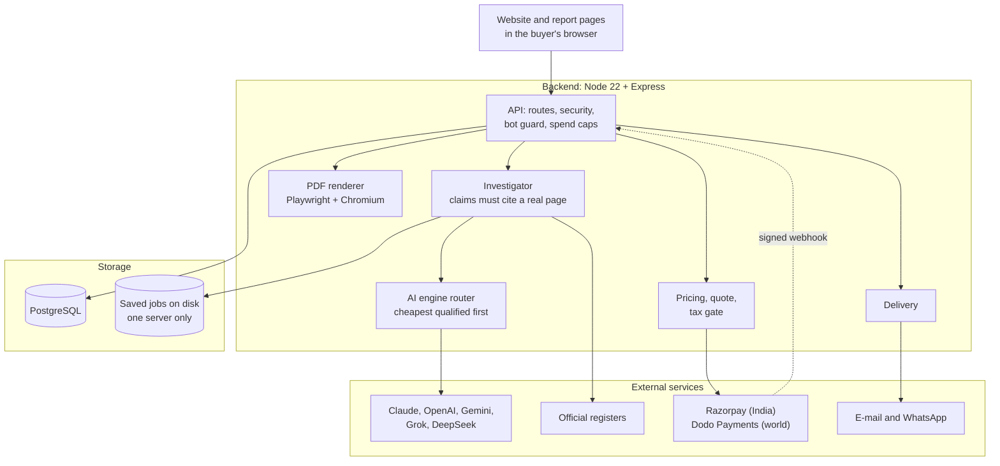
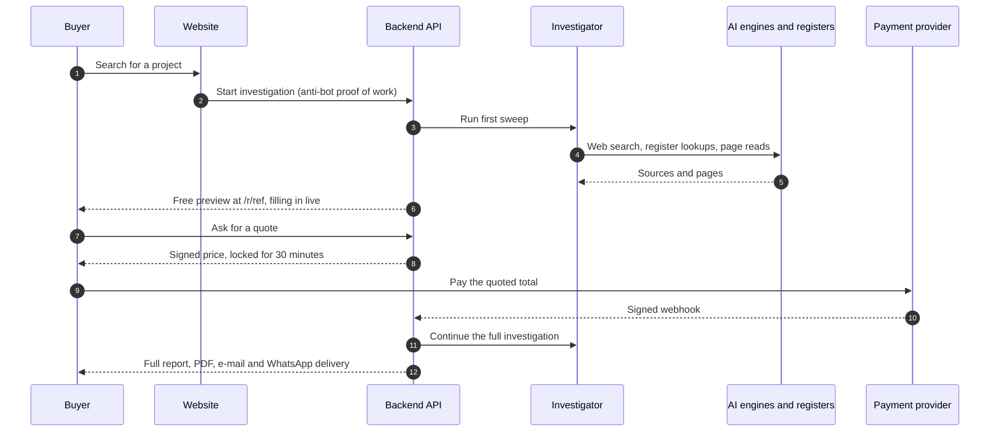
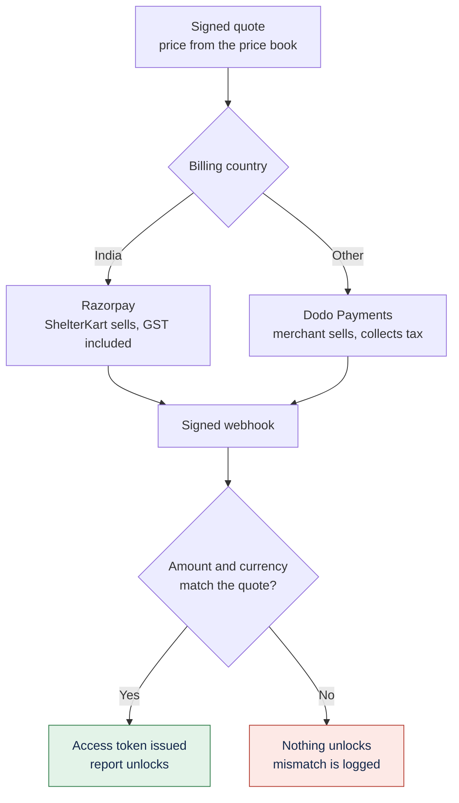

# Architecture

What runs, how a buyer moves through it, and how a payment is decided. The diagrams are Mermaid, so they stay next to the code they describe.

## Components

The backend is an API and report pages; the website is separate. Everything an investigation needs goes through the engine router, so no AI vendor is preferred by name, and the investigator only keeps claims that cite a page the search really returned.

## Buyer journey

A new investigation starts only after a short proof of work in the browser. The price comes from the price book on the server, never from the page, and the quote is signed and valid for 30 minutes.

## How a payment is decided

India is sold by ShelterKart through Razorpay with GST included. Everywhere else a Merchant of Record (Dodo Payments) is the legal seller and collects the buyer's tax. A market opens only when every piece it needs is configured; a missing piece closes it.

## Known limits

Saved investigations are files on one server, so only one instance is safe (tracked on the board as the job-store item). Nothing has run against real payment, AI or delivery credentials yet.
