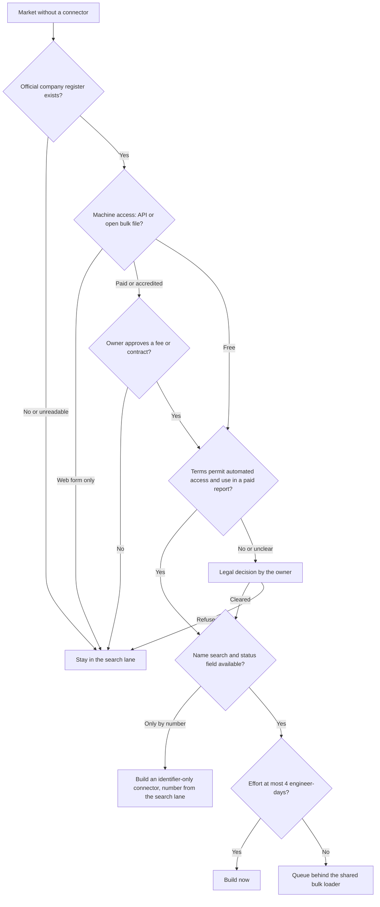

# Registry connector feasibility study (SHEL-23)

Date of study: 2026-10-27. Scope: the 26 markets in `backend/engine/markets.js` that have no entry in `CONNECTORS` in `backend/engine/registry.js`. Method: public documentation, terms and developer pages only. No register API was called and no site was scraped.

## How to read the evidence

Every evidence line carries one of two tags.

- `[read]` means the page was fetched during this study and stated the point.
- `[summary]` means the point comes from a web-search result summary, or the page itself could not be fetched (HTTP 403, 404, 500, connection refused, or a script-only page). Treat these as leads, not facts, until someone reads the page.

Anything neither tagged nor stated is `unverified`. Terms verdicts are an engineering reading of short passages, not legal advice; the owner or a lawyer has to confirm any verdict marked "legal check".

## What a connector must be (checked in the repo)

- Shape in `registry.js`: an object with `market`, `hosts` and `async lookup(name, { http, env, ids, localName })` returning `{ match, findings, pages }`, with `skipped` when a key or consent flag is absent. Findings are fixed templates with the register URL attached and `lane: 'registry'`; a missing or unexpected field produces no claim.
- The interactive path in `engine/research.js` calls `lookup` with the developer's name (never the project name) under a deadline of at most 15 seconds, so a connector is a few live HTTP calls. Only `GET` and `POST` with headers and a JSON body pass through `engine/registryHttp.js`. There is no storage step in this path.
- Egress: `connectors/egress.js` allows only hosts listed in `hosts`, over HTTPS, re-validates every redirect and refuses private addresses. A connector whose data sits on a second host (a bulk file host, an OAuth token host) must list that host too.
- Untrusted content: register text is written by the entity being assessed (names, business descriptions, objects). `connectors/untrusted.js` requires such text to travel as delimited data, never inside an instruction, and any extracted value must be literally present in the source document. Free-text register fields (for example Swedish business descriptions) should be left out of findings or enclosed as untrusted.
- Health: `engine/health.js` runs a canary per market (`CANARIES` keyed by market code) and checks `robots.txt` for the paths the connector used; a blocked path switches the register off. A canary needs a known company and identifier confirmed against the live register, so the first real call happens during the build, not in this study.
- Registers file: `backend/data/registers.json` needs an entry (id, name, hosts, licence, credit, `confirmed: false`), and `engine/markets.js` flips `registry` from `null` once the connector passes tests with an injected mock `http`.
- Present connectors read one live endpoint with name search (GB, FR, NO, SG, FI, CZ, AU, IE, TW) or one page by number (IN). A bulk-file source does not fit this shape without a new loader and store.

Effort baseline used below: one engineer-day is a focused day. A clean, documented, keyless live API with name search costs about 2 days (client, parser, mock tests, allow-list, registers entry, canary verification). Add 1 day for key or OAuth handling, 1 to 2 days when lookup is by identifier only, and about 3 days once for a first bulk-file loader (scheduled download, parse, index, store, freshness check), which later bulk markets then reuse at 1 to 2 days each.

## Summary table

| Market | Source | Access | Key or fee | Terms verdict | Rating | Effort |
|---|---|---|---|---|---|---|
| Estonia | e-Business Register autocomplete and open data | Free live autocomplete (name to code, status); bulk files; contract API | None for autocomplete | Permitted: autocomplete and open data are named exceptions to the no-scripts rule; CC BY 4.0 | High | 2 days |
| Japan | NTA Corporate Number Web-API | Free API with name search | Free application ID, 2 to 4 weeks, Japanese-language procedure | Permitted with attribution; no short-time mass access | High | 3 days plus lead time |
| Latvia | Enterprise Register open data on data.gov.lv | Daily bulk CSV; no API on the dataset page | None | Permitted: CC0, commercial use allowed | Medium | 4 days including the first bulk loader |
| Lithuania | Register of Legal Entities dataset on data.gov.lt | Monthly bulk and a storage API [summary] | None | CC BY 4.0 [summary] | Medium | 3 days |
| Sweden | Bolagsverket valuable datasets API | Free REST API, lookup by organisation number only | Application form for OAuth credentials; no agreement; no fee | Permitted: commercial use and combination allowed | Medium | 3 days |
| Denmark | CVR system-to-system (Elasticsearch) | Free JSON search API with credentials | Email application and an advertising-protection declaration [summary] | Terms page not readable; legal check | Medium | 3 days |
| Switzerland | Zefix public REST API | Free API with Basic authentication | Credentials by email request [summary] | Open government data with source credit [summary]; legal check | Medium | 3 days |
| United States | SEC EDGAR; New York DOS dataset; Florida bulk files | Free APIs and bulk | None; SEC needs a declared User-Agent and 10 requests a second | SEC allows scripted access within fair-access rules; NY licence not stated; Florida page unreadable | Medium | 4 days |
| Poland | KRS Open API; REGON API | Free API by KRS number; REGON by REGON, NIP or KRS | REGON key by email; KRS none [summary] | Open-data law basis [read]; limits unverified | Medium (number only) | 2 days |
| Belgium | KBO (CBE) open data | Free daily bulk files | Registration and licence acceptance | Licence text not read; legal check | Medium | 5 days |
| New Zealand | NZBN API, Companies Office APIs and bulk data | Free API with subscription key | Signed MBIE API access agreement | Restricts use for commercial gain, selling and solicitation; legal check | Medium (legal gate) | 3 days |
| Dubai / UAE | Dubai Pulse DED licence and DLD developer datasets | API with key and secret after a dataset grant [summary] | Approval needed (already pending per `markets.js`) | Terms not read | Medium (pending) | 4 days after approval |
| Brazil | Receita Federal CNPJ open data | Monthly bulk files | None | Licence wording not confirmed | Medium | 7 days |
| Thailand | DBD open API and DataWarehouse | Keyless open API reported [summary]; DataWarehouse is Thai-only with no API stated [read] | Unverified | Unverified | Low | Spike first, then 3 days |
| Canada | Corporations Canada (federal only) | Daily CSV bulk; API by ID with key | Account for key | OGL-Canada, federal only | Low | 3 days |
| Hong Kong | CR lists on data.gov.hk; e-Search | Name, BR number and address lists via API; paid particulars | Free lists; HK$22 per company report | Reuse permitted with attribution; status and directors not shown on the dataset page | Low | 2 days for lists only |
| Spain | BOE BORME gazette API | Daily gazette summaries by date; no name search | None | Reuse permitted with attribution | Low | 6 days |
| Germany | Handelsregister portal | No official API; web portal with a 60 queries per hour cap [summary] | Free manually | Automated use restricted | None | not recommended |
| Netherlands | KVK Handelsregister APIs and open dataset | Paid API for NL-registered signatories; open dataset has no names | Monthly fee and per-request fee | Private and foreign use excluded | None for name lookup | not recommended |
| Portugal | publicacoes.mj.pt | Free human search by name or NIPC; no machine access stated | None | No automation terms read | None | not recommended |
| Italy | Registro Imprese via InfoCamere | Paid contract API [summary] | Unpublished contract price [summary] | Not read | None | not recommended |
| Saudi Arabia | Wathq API; Wafi public inquiries | Wathq paid and accredited [summary]; Wafi search is a web page | Accreditation and fee [summary] | Not read | Low | not recommended |
| South Africa | CIPC | No API found; paid data extracts | Fee per extract | Not read | None | not recommended |
| Malaysia | SSM via licensed providers; TEDUH | Paid provider portals [summary]; no API found | RM15.40 per profile [summary] | Not read | None | not recommended |
| Philippines | SEC eSearch | Paid certifications [summary]; no API found | P500 per certification [summary] | Not read | None | not recommended |
| Mexico | SIGER (RPC); INEGI DENUE | No open company-name API confirmed | Unverified | Unverified | None | not recommended |

High feasibility: 2 markets (Estonia, Japan). Medium: 11. Low: 5. None: 8. Counts follow the rating column above and total 26.

## Decision flow

## Markets, one section each

### Estonia (ee) - high, about 2 days

- Source: e-Business Register (Registrite ja Infosüsteemide Keskus, RIK), open data environment.
- Access: three routes. Free autocomplete endpoint needing no agreement; downloadable open datasets; XML and open-data API services under a signed contract. The autocomplete returns a company ID, registry code, current name, former names, status, legal address, postcode and a link, at most 10 results sorted by name, address `https://ariregister.rik.ee/est/api/autocomplete?q=name` `[read]`.
- Key or fee: autocomplete needs none `[read]`. The contract API is free when it covers only e-Business Register API services, needs authentication with a register user name and password, allows 50 000 answers a day and 1 concurrent query, and the contract takes about 5 working days to review `[read]`.
- Terms: results are under CC BY 4.0 `[read]`. The general terms prohibit use "by automated scripts, programs or tools" with named exceptions for the autocomplete function, open data and XML services with a contract `[read]`. Fees still apply to non-profit public-file documents `[read]`.
- Fields: name, registry code, status, address; board members and beneficial owners sit behind the contract API `[read]`. Language: Estonian and English interface.
- Evidence: https://avaandmed.ariregister.rik.ee/en/node/31 `[read]`, https://avaandmed.ariregister.rik.ee/en/open-data-api/introduction-api-services `[read]`, https://www.rik.ee/en/asutusest/kasutustingimused `[read]`, https://abiinfo.rik.ee/en/e-business-register-queries/open-data-e-business-register `[read]`, https://avaandmed.ariregister.rik.ee/en `[read]`.
- Risk: the 10-result cap needs a name-score filter like the existing `pickBest`; the status vocabulary and the response field names were not read, so the parser must be written against one real response. Autocomplete matches names, not necessarily every legal form.

### Latvia (lv) - medium, about 4 days

- Source: Enterprise Register (Uzņēmumu reģistrs) open data on the national portal.
- Access: bulk CSV `register.csv`, refreshed daily, containing entity type, legal address, current name, registration number, registration date and removal or reorganisation dates `[read]`. The dataset page names no API `[read]`. A dedicated register-column description file was reported but not read `[summary]`.
- Key or fee: none.
- Terms: CC0-1.0 on the dataset page `[read]`; the register's page allows distribution without restriction, commercial use included `[read]`.
- Language: Latvian. Contact for the data: dati@ur.gov.lv `[read]`.
- Evidence: https://data.gov.lv/dati/eng/dataset/uz `[read]`, https://ur.gov.lv/en/open-data-sets-register-open-data-portal-latvia `[read]`, https://dati.ur.gov.lv/ `[read]`.
- Risk: needs the bulk loader, so it pays for the shared tranche. The file does not appear to carry officers or a status field beyond removal dates (column list not read in full). The earlier note in `registry.js` that Latvia was "not in a searchable datastore" matches this: the data is open but only as a file.

### Poland (pl) - medium by number only, about 2 days

- Source: KRS Open API (Ministry of Justice) and the REGON API (Statistics Poland).
- Access: the KRS Open API was launched on 8 March 2022 under the 2021 open-data and reuse act and returns data matching the full current extract, with GDPR treatment `[read]`; the current-extract endpoint takes a KRS number and register type, and person names and PESEL numbers are anonymised `[summary]`. REGON supports lookups by REGON, NIP or KRS number only; no name search is documented `[read]`.
- Key or fee: REGON is free but a production key is issued after an email request with entity details, expected IP addresses and concurrent users `[read]`. KRS needs no key `[summary]`.
- Limits: REGON 6 000 calls an hour and 3 a second at peak, 10 000 an hour and 4 a second at night `[read]`. KRS limits not found.
- Language: Polish. Name resolution needs the KRS number from the search lane, so this is an identifier-only connector like India's.
- Evidence: https://www.gov.pl/web/sprawiedliwosc/uruchomienie-otwartego-api-krajowego-rejestru-sadowego `[read]`, https://api.stat.gov.pl/Home/RegonApi `[read]`, https://prs.ms.gov.pl/krs/openApi `[summary]` (script-only page).
- Risk: response field names and the exact endpoint contract were not read from the official documentation; terms and limits for KRS are unverified; a legal commentary page on API download legality could not be read.

### Spain (es) - low, about 6 days

- Source: BORME, the official commercial-register gazette, on BOE open data.
- Access: `GET /datosabiertos/api/borme/sumario/{date}` returns the day's summary in XML or JSON; no company-name search `[read]`. A name lookup would mean indexing every day's gazette.
- Key or fee: no key mentioned `[read]`.
- Terms: reuse for commercial and non-commercial purposes, including extraction and combination, with a mandatory source line; no restriction on bulk or robots stated; personal-data law applies `[read]`.
- Language: Spanish.
- Evidence: https://www.boe.es/datosabiertos/ `[read]`, https://www.boe.es/informacion/aviso_legal/index.php `[read]`. Registro Mercantil company certificates are paid and sold through intermediaries `[summary]`.
- Risk: gazette acts only (incorporations, appointments, dissolutions), not a status register; coverage per company is partial.

### Lithuania (lt) - medium, about 3 days

- Source: Register of Legal Entities (Registrų centras) dataset on data.gov.lt.
- Access: dataset "legal entities registered in the Register of Legal Entities" with code, name and registration date, updated monthly, in CSV, JSON, JSONL, RDF and a storage API `[summary]`. Names of sole proprietorships and partnerships are anonymised `[summary]`.
- Key or fee: none stated.
- Terms: CC BY 4.0 `[summary]`. The register's own open-data page returned HTTP 403.
- Language: Lithuanian.
- Evidence: https://data.gov.lt/datasets/1484/ `[summary]` (page returned HTTP 500 when fetched), https://www.registrucentras.lt/atviri_duomenys `[summary]` (HTTP 403).
- Risk: monthly refresh makes status stale for a trust product; the storage API's query syntax was not read; anonymised names weaken matching for small entities.

### Denmark (dk) - medium, about 3 days

- Source: CVR, run by the Danish Business Authority (Erhvervsstyrelsen).
- Access: system-to-system access serving CVR JSON from Elasticsearch, near real time `[summary]`. Access needs a user ID and password; a badly designed query may get access temporarily blocked; there is no direct database access and results per search are capped by the `size` parameter `[read]`.
- Key or fee: free, applied for by email to cvrselvbetjening@erst.dk, followed by a declaration to comply with the rules for advertising-protected entities `[summary]`; the guide itself does not describe the application, cost or eligibility `[read]`.
- Terms: the terms page returned HTTP 403; explicit rate limits and pricing are not stated in the guide `[read]`.
- Language: Danish.
- Evidence: https://erhvervsstyrelsen.dk/kom-godt-igang-med-elasticSearch `[read]`, https://erhvervsstyrelsen.dk/det-centrale-virksomhedsregister-cvr `[read]` (points to datacvr.virk.dk for access terms), http://datahub.virk.dk/dataset/system-til-system-adgang-til-cvr-data `[summary]` (host did not resolve), https://datacvr.virk.dk/artikel/vilkaar-og-betingelser `[summary]` (HTTP 403).
- Risk: a signed declaration and a credential issued per applicant; the owner decides who signs. Query DSL work is larger than a plain REST lookup.

### Switzerland (ch) - medium, about 3 days

- Source: Zefix, the central business-name index of the Federal Office of Justice.
- Access: REST API with a Swagger page; the page shows Basic authentication `[read]`. Data returned: name, seat, legal form, status, purpose and gazette publications `[summary]`.
- Key or fee: free; credentials requested by email to zefix@bj.admin.ch `[summary]`.
- Terms: open government data usage requiring a source credit `[summary]`; the interface catalogue page gave no terms text `[read]`. A subset is also on opendata.swiss under an open-data licence `[summary]`.
- Language: German, French, Italian names; English interface text unverified.
- Evidence: https://www.zefix.admin.ch/ZefixPublicREST/swagger-ui/index.html `[read]` (header only), https://www.i14y.admin.ch/en/catalog/dataservices/6ef8f5d2-3d6a-4d84-bf60-5e65fde98a87 `[summary]`, https://opendata.swiss/en/dataset/zefix-zentraler-firmenindex `[summary]` (HTTP 403).
- Risk: the credential process and terms were not read at the source; swiss legal forms need adding to the suffix stripper.

### Belgium (be) - medium, about 5 days

- Source: Crossroads Bank for Enterprises (KBO/BCE), FPS Economy.
- Access: free open-data files of active entities after registration (the portal shows a sign-up and login), plus a separate Public Search Web Service mentioned without pricing `[read]`. Daily files and SFTP delivery were reported `[summary]`.
- Content: denomination, status, enterprise number and juridical situation of active entities `[read]`.
- Terms: licence text not read; the download cookbook returned a CAPTCHA page `[read]`.
- Languages: Dutch, French, German names.
- Evidence: https://kbopub.economie.fgov.be/kbo-open-data `[read]`, https://economie.fgov.be/sites/default/files/Files/Entreprises/KBO/Cookbook-KBO-Open-Data.pdf `[summary]`.
- Risk: bulk loader needed; active entities only, so a dissolved company returns no match, which a reader may take as "not found" and must be reported as "not in the active file".

### Sweden (se) - medium, about 3 days

- Source: Bolagsverket valuable-datasets API, with SCB data.
- Access: REST and JSON; queries by organisation number, document list by number and single document retrieval; no name search documented `[read]`. Fields: organisation number, name, organisation form, business description, SNI codes, postal address, registration date, legal status and digitally filed annual reports `[read]`. Downloadable files also exist `[read]`.
- Key or fee: free, no agreement; OAuth 2.0 client ID and secret issued on a customer application form, test and production, sent by email and SMS `[read]`.
- Limits: 60 questions a minute per user `[read]`.
- Terms: commercial and non-commercial use, modification and combination allowed subject to data-protection and confidentiality law; licence detail deferred to the digital-government authority `[read]`.
- Language: Swedish.
- Evidence: https://bolagsverket.se/apierochoppnadata/hamtaforetagsinformation/vardefulladatamangder/apiforvardefulladatamangder.5513.html `[read]`, https://bolagsverket.se/apierochoppnadata/hamtaforetagsinformation/vardefulladatamangder.5294.html `[read]`.
- Risk: identifier-only, so the number must come from the search lane or the bulk file; the business description is registrant-written text and must be treated as untrusted. A token host may need allow-listing.

### Dubai / UAE (ae) - medium, pending, about 4 days after approval

- Source: Dubai Pulse open data (Dubai Land Department developer registry; Department of Economy and Tourism licence master).
- Access: datasets listed include business licences for mainland Dubai and licences recorded by the Land Department's real estate regulator, plus a developers dataset `[summary]`. API access issues a key and secret on first dataset grant, exchanged for a short-lived token `[summary]`.
- Key or fee: key and secret after approval; fees unverified. `engine/markets.js` already records approval as pending.
- Terms: each dataset page carries an acknowledgement of terms; text not read; the dataset pages refused connections when fetched.
- Language: English and Arabic fields unverified.
- Evidence: https://www.dubaipulse.gov.ae/data/dld-registration/dld_developers-open `[summary]`, https://www.dubaipulse.gov.ae/data/ded-licenses/ded_license_master-open `[summary]`.
- Risk: blocked on approval; field names unseen; the developer register is more useful here than a company register.

### Hong Kong (hk) - low, about 2 days for lists only

- Source: Companies Registry datasets on data.gov.hk, and the e-Services Portal.
- Access: API endpoints for registered-office addresses of live local companies and non-Hong Kong companies, refreshed daily `[read]`; the page did not list fields or whether status or directors are present `[read]`. Company name, document index and charge index searches on the portal are free; company particulars HK$22 per company, directors HK$11 to 22 per person, annual e-Search subscription HK$500 `[read]`. The Third Party Software Interface supports document filing and transmission, not search `[read]`.
- Terms: data.gov.hk allows free commercial and non-commercial reuse with attribution, provided "as is"; it says nothing on API limits `[read]`. The e-Services portal terms were not found.
- Language: English and Chinese.
- Evidence: https://data.gov.hk/en-data/dataset/hk-cr-crdata-list-addr `[read]`, https://data.gov.hk/en/terms-and-conditions `[read]`, https://www.cr.gov.hk/en/public/fees.htm `[read]`, https://www.cr.gov.hk/en/electronic/e-servicesportal/faq/tpsi.htm `[read]`.
- Risk: no status field established, so a connector could confirm existence but not standing. Keep in the search lane unless the owner pays per search through an authorised route (not found).

### New Zealand (nz) - medium, legal gate, about 3 days

- Source: NZBN API on the MBIE portal; Companies Office APIs and bulk data.
- Access: NZBN API returns business name and trading names, entity status and type, addresses and industry classification `[read]`. The Companies Register API is for filing, not search `[read]`. The entity role search finds directors and shareholders by person name, not company name `[read]`. Companies Office bulk CSV snapshots are monthly, free once access is granted `[read]`.
- Key or fee: free; a subscription key plus a signed MBIE API access agreement `[read]` `[summary]`.
- Terms: the support page states restrictions on using API information for commercial gain, selling, solicitation and identifying persons `[read]` (page partly broken when fetched); the bulk agreement allows research and business use and bans direct marketing and passing data to unauthorised people `[read]`.
- Rate limits: not stated for the NZBN API `[read]`.
- Language: English.
- Evidence: https://portal.api.business.govt.nz/api/nzbn `[read]`, https://portal.api.business.govt.nz/api/companies-entity-role-search `[read]`, https://www.companiesoffice.govt.nz/data-services/ways-to-get-our-data/bulk-data-access-agreement/ `[read]`, https://support.api.business.govt.nz/s/article/historic-access-agreements `[read]`.
- Risk: legal check on whether a paid property-trust report counts as use "for commercial gain". Raw response field names were not read; `registry.js` already records that they were undocumented when last examined.

### Canada (ca) - low, about 3 days

- Source: Corporations Canada (federal), with provincial registers and the Ontario builder directory outside it.
- Access: federal open data in CSV, English and French, typically daily, excluding provincially incorporated entities and financial institutions `[read]`. API by corporation ID or 9-digit business number only, key in a `user-key` header, no name-search endpoint, and an unknown corporation returns HTTP 200 with an error message `[read]`.
- Key or fee: account on the API store for a key; fees not stated `[read]`.
- Terms: Open Government Licence - Canada `[read]`.
- Language: English and French.
- Evidence: https://open.canada.ca/data/en/dataset/0032ce54-c5dd-4b66-99a0-320a7b5e99f2 `[read]`, https://api.ised-isde.canada.ca/swagger/spec/corporations-en.json `[read]`, https://ised-isde.canada.ca/site/corporations-canada/en/node/269 `[read]`.
- Property side: the Ontario Builder Directory (HCRA) is searchable by builder name, licence number or principal, with status and regulatory actions `[summary]`; the HCRA terms page was fetched but showed no terms text, so automated access is unverified.
- Risk: most developers are provincially incorporated, so federal coverage is thin.

### Malaysia (my) - none, not recommended

- Source: SSM sells profiles through licensed provider portals (SSM e-Info, MyData-SSM, SSM Search, SafeData) at about RM15.40 per profile `[summary]`. An SSM notice lists the platforms and phased data restoration without fees or an API `[read]`.
- Property side: the TEDUH housing portal shows developer licence and advertising permit status to the public `[summary]`; its page text was script-only, and no API or terms were found `[read]`.
- Evidence: https://ssm.com.my/bm/Lists/Announcement/AnnouncementDetails.aspx?ID=488 `[read]`, https://teduh.kpkt.gov.my/ `[read]` (header only).
- Risk: no machine access found; paid per record.

### United States (us) - medium, about 4 days

- Source: three separate pieces for the pilot states and listed companies.
- SEC EDGAR: submissions API at `data.sec.gov` by CIK, no key; metadata includes current and former names and tickers `[read]`; no company-name search endpoint appears in the API document `[read]`. Fair access: 10 requests a second, a declared User-Agent with contact details, no crawling by botnets or automated tools outside policy `[read]`. Only SEC filers appear, so private developers are absent.
- New York: DOS active corporations dataset, monthly, 4 306 064 rows at the time read, with DOS ID, entity name, filing date, county, jurisdiction, entity type and addresses; licence not stated in the metadata `[read]`; whether the open-data portal's query API and token rules apply was not read.
- Florida: quarterly full file and daily files by public SFTP `[summary]`; the Division page returned HTTP 403.
- Language: English.
- Evidence: https://www.sec.gov/os/accessing-edgar-data `[read]`, https://www.sec.gov/search-filings/edgar-application-programming-interfaces `[read]`, https://data.ny.gov/api/views/n9v6-gdp6 `[read]`, https://dos.fl.gov/sunbiz/other-services/data-downloads/ `[summary]`.
- Risk: no single US register; New York is a monthly file, so freshness is weak; Florida needs the bulk loader; two connectors (SEC, New York) fit the live shape only if the New York query API is confirmed.

### Germany (de) - none, not recommended

- Source: Handelsregister portal of the states.
- Access: free manual search with no account; no official API is offered and queries run through a session-bound interface `[summary]`. The usage terms cap retrievals at 60 an hour and describe automated mass queries as potentially criminal under sections 303a and 303b of the German Criminal Code `[summary]` (quoted by a community repository that reverse-engineers the portal, not read at handelsregister.de). Higher volumes by application with a registered IP address `[summary]`.
- Evidence: https://github.com/bundesAPI/handelsregister `[read]`; the portal's terms page could not be fetched.
- Risk: the 60 per hour cap and the legal language rule out a live connector for an interactive product. Paid aggregators exist; that is a fee decision for the owner.

### Netherlands (nl) - none for name lookup, not recommended

- Source: KVK Handelsregister.
- Access: subscription APIs at EUR 6.40 a month per key plus EUR 0.02 a query, Zoeken search free; applicants must be registered in the Dutch Business Register and authorised to sign, and the page states this excludes private use `[read]`. The free open dataset excludes the KVK number and organisation name and covers only BV and NV, 1 request a minute per IP and 200 per 5 minutes overall `[read]`. The open dataset API is by KVK number only `[read]`.
- Terms: CC BY 4.0 for the open dataset `[read]`.
- Evidence: https://developers.kvk.nl/faq `[read]`, https://www.kvk.nl/en/ordering-products/kvk-business-register-open-data-set/ `[read]`, https://developers.kvk.nl/documentation/open-dataset-basis-bedrijfsgegevens-api `[read]`.
- Risk: a foreign business may not qualify for the paid API; whether an Indian operator or a Dutch entity signs is an owner decision.

### Portugal (pt) - none, not recommended

- Source: Ministry of Justice publications portal.
- Access: free search of mandatory company publications by name or NIPC; the page says it works from any standard browser and states no API or bulk data `[read]`. Permanent certificates are paid subscriptions `[summary]`.
- Evidence: https://publicacoes.mj.pt/ `[read]`.
- Risk: no machine access documented; terms on automation not read.

### Italy (it) - none, not recommended

- Source: Registro Imprese, run by the Chambers of Commerce through InfoCamere.
- Access: free name search on the website; extracts about EUR 3 to 10 and a paid Telemaco account for batch use; the InfoCamere web service needs a commercial contract with unpublished pricing `[summary]`.
- Evidence: https://www.topograph.co/guides/business-register-in-italy `[summary]` (third-party guide; no official page read).
- Risk: paid contract; unverified terms.

### Saudi Arabia (sa) - low, not recommended

- Source: Ministry of Commerce Wathq API; REGA Wafi programme.
- Access: Wathq is described as an accredited-access platform with per-call pricing from about SAR 2 `[summary]`. Wafi's public inquiries section lists licensed projects (name, developer, location, licence type, status) and a developer registry with licence number and validity, without login, and mentions an open-data section `[read]`; no API or terms found.
- Evidence: https://rega.gov.sa/en/rega-services/platforms/wafi-off-plan-sales-and-lease/ `[read]`.
- Risk: the useful data is the developer and project register on a web form; scraping it is out of scope and terms are unread.

### South Africa (za) - none, not recommended

- Source: CIPC.
- Access: no company-data API found. CIPC's page lists electronic data extracts at R10 plus R0.04 per record and disclosure certificates at R30 `[read]`; the page also states that its premium search facility is not free `[read]`. Whether bulk scripted download is allowed was not found; one third-party guide says it is not `[summary]`.
- Evidence: https://www.cipc.co.za/?page_id=3441 `[read]`.
- Risk: fee per record; unverified terms; the home-builder register (NHBRC) was not studied.

### Brazil (br) - medium, about 7 days

- Source: Receita Federal CNPJ open data.
- Access: monthly bulk files of the national company register, split for download; the layout document lists company name, registration status (codes for null, active, suspended, unfit, struck off), dates, activity code and capital, and states that partner CPF numbers are masked `[read]` `[summary]`. The national open-data portal lists the dataset with a licence field, not displayed in the fetched text `[read]`.
- Key or fee: none.
- Terms: a Creative Commons attribution licence reported `[summary]`; unconfirmed at source. The Receita host refused or returned not-found for the file listing when fetched.
- Language: Portuguese.
- Evidence: https://dados.gov.br/dados/conjuntos-dados/cadastro-nacional-da-pessoa-juridica---cnpj `[read]`, https://www.gov.br/receitafederal/dados/cnpj-metadados.pdf `[read]`.
- Risk: very large files; needs the bulk loader plus a name index; monthly freshness. A CNPJ-by-number route is cheaper if the number comes from the search lane.

### Japan (jp) - high, about 3 days plus lead time

- Source: National Tax Agency Corporate Number Publication Site Web-API.
- Access: free; version 2.0 and later search by corporate name with optional location and entity-type filters; returns corporate name, head-office location and corporate number, with change history, English name (from 2.0) and katakana reading (from 3.0); at most 10 numbers per request and a 50-day period for period queries; the full dataset cannot be pulled through the API `[read]`.
- Key or fee: an application ID is free, takes about 2 to 4 weeks, and is requested through the NTA's invoice-system channel `[read]`. Procedures and inquiries are in Japanese `[read]`.
- Terms: no explicit ban on automation, but "short-time mass access" and acts that interfere with operations are prohibited, the NTA may restrict use at times of excessive concentration, a credit sentence is required on redistribution, credentials may not be transferred, and access lapses after 3 years of inactivity `[read]`.
- Language: Japanese, with English name where recorded.
- Evidence: https://www.houjin-bangou.nta.go.jp/webapi/ `[read]`, https://www.houjin-bangou.nta.go.jp/webapi/riyokiyaku.html `[read]`.
- Risk: whether a closure or process status comes back in the response was not confirmed; Japanese script needs the same whole-string matching used for Taiwan; the licensed-real-estate register named in `markets.js` is a separate source not studied here. Start the application early because it gates the build.

### Thailand (th) - low, spike first

- Source: Department of Business Development (DBD).
- Access: DataWarehouse+ offers juristic-person and financial-statement search, interface in Thai only, with no API or automated-access statement `[read]`. A keyless open API at `openapi.dbd.go.th` returning name, status, registration date, capital and address under an open government licence was reported by third-party pages `[summary]`; the host returned HTTP 403 and the DBD home page showed no data links `[read]`.
- Evidence: https://datawarehouse.dbd.go.th/ `[read]`, https://www.dbd.go.th/ `[read]`.
- Risk: the only machine route is unverified. A half-day spike to read the open API terms would settle the rating.

### Philippines (ph) - none, not recommended

- Source: SEC; the company verification tool and eSearch.
- Access: a "Check with SEC" verification tool and an eSearch portal for requesting copies; certifications reported at P500 each `[summary]`. No API found.
- Evidence: https://checkwithsec.sec.gov.ph/ `[summary]` (HTTP 403), https://appointment.sec.gov.ph/online-services/sec-company-registration-system/ `[summary]`.
- Property side: the housing regulator's licence to sell (named in `markets.js`) was not studied.
- Risk: no machine access found.

### Mexico (mx) - none, not recommended

- Source: the commercial public registry (SIGER) and INEGI's business directory (DENUE).
- Access: no free company-name API confirmed. DENUE is a business-establishment directory with an API requiring a token `[summary]`; it is not a legal register and its terms were not read; the INEGI host refused the connection when fetched.
- Evidence: https://rpc.economia.gob.mx/siger2/resources/docs/avisoPrivacidadIntegral.pdf `[summary]`.
- Risk: not a legal-status source; unverified terms.

## Ranked recommendation

Ranking criterion: markets covered per engineer-day, then data quality (name search and status), then dependence on third parties. Efforts are from the table above.

1. Estonia (about 2 days). Free, no contract, name to code and status, an explicit terms exception for the autocomplete function. Best ratio in the study.
2. Japan (about 3 days, plus 2 to 4 weeks lead). Free name-search API; the only blocker is the application ID, so file it now. Japan has no connector today and is a large market.
3. Sweden (about 3 days). Free, no agreement, commercial reuse stated; identifier-only, so pair it with the search lane for the organisation number.
4. Switzerland (about 3 days). Free live API with name search once credentials arrive; confirm the credential terms at the source first.
5. Denmark (about 3 days). Free, strong data, near real time; needs the advertising-protection declaration signed.
6. Latvia (about 4 days including the first bulk loader). CC0, clean terms. Building it creates the loader that Lithuania (add about 1.5 days), Belgium (add about 2 days, after registration) and Brazil (add about 4 days, with an index) can reuse.
7. United States, New York with SEC (about 4 days). Two live sources fit the existing shape; fold Florida in after the bulk loader exists.
8. Dubai (about 4 days once approval lands). Already in progress with Dubai Pulse; a developer register adds more than a company register would in this market.

Total for 1 to 7, including the bulk loader but excluding Dubai: about 22 engineer-days for 7 new markets, a little over 3 days per market.

Stay search-lane only, and why:

- Germany: no official API, a 60 queries per hour cap and criminal-law warnings against automated queries.
- Netherlands: the paid API is limited to Dutch-registered signatories and excludes private use; the open dataset has no names.
- Portugal, Italy, South Africa, Philippines, Malaysia, Mexico: no machine access found, or access only by paid record, contract or accreditation.
- Spain: gazette by date only; an index would cost 6 days for partial coverage.
- Hong Kong: lists have no status; the paid search is per company.
- Canada: federal register only, while most developers sit in provincial registers.
- Saudi Arabia and Thailand: the useful sources are unverified or web forms; Thailand deserves a half-day spike because a keyless API was reported.

Needs an owner fee or legal decision before building:

- New Zealand: whether a paid report counts as use "for commercial gain" under the MBIE access agreement.
- Denmark: who signs the advertising-protection declaration.
- Sweden and Japan: who files the application; Japan's procedure is in Japanese.
- Switzerland and Belgium: who requests the credentials or registration and accepts the licence.
- Netherlands, Italy, Saudi Arabia, South Africa, Hong Kong, Germany: a fee or contract (or a paid aggregator) is the only route to machine access; each should be priced before any work.
- Dubai: the pending Dubai Pulse approval.
- Every market: `confirmed` in `registers.json` stays false until a lawyer approves the attribution wording.

## What was not verified

- Terms pages that could not be read: Denmark (datacvr.virk.dk), Switzerland (Zefix and opendata.swiss), Belgium (licence), Dubai Pulse (all dataset pages), Germany (handelsregister.de), Lithuania (Registrų centras and the portal page), Florida, Brazil (Receita file host), Thailand (open API), Mexico, Philippines and Italy.
- No response structure was read for any market, so no parser can be written from this document alone. Each build starts with reading one real response and setting a canary.
- Coverage figures, such as how many developers each register holds, were not measured.
