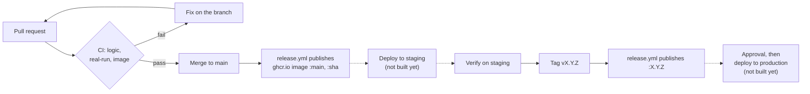
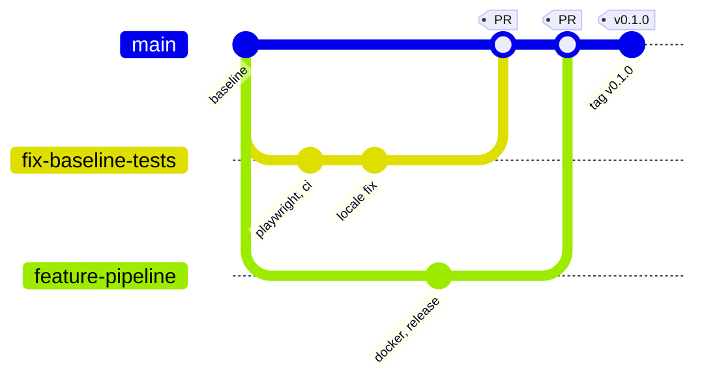

# Delivery pipeline

How a change travels from a branch to production. The rules for branches, commits and pull requests are in [CONTRIBUTING.md](../CONTRIBUTING.md); what a host must provide is in [DEPLOYMENT.md](DEPLOYMENT.md).

## From pull request to production

Merging to `main` publishes an image tagged `:main` and `:sha-<commit>`; a version tag publishes `:X.Y.Z`. The two deploy steps are drawn dashed because no hosting target is chosen yet, so nothing starts the image on a server.

## Branches

Short-lived branches off `main`, merged through pull requests. There is no `develop` or `test` branch: testing is CI on every pull request and the staging environment after merge.

