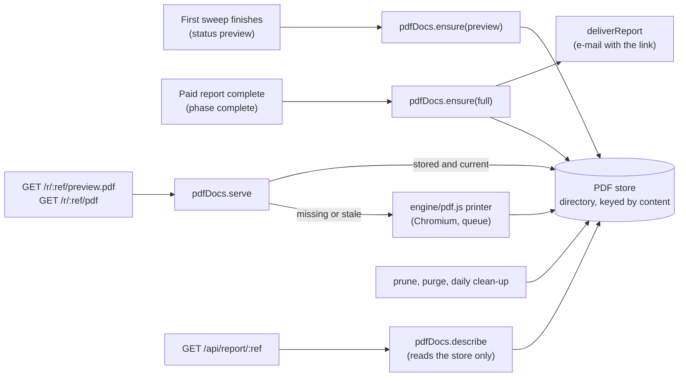

# Report PDFs: technical design

Companion to `PRD.md`. Written 14 November 2026 after reading `engine/pdf.js`, `engine/dossierHtml.js`, `modules/investigate.js`, `services/liveReports.js` and `engine/reportView.js` on `main`.

## 1. What exists today

| Piece | Where | Behaviour |
| --- | --- | --- |
| Printer | `engine/pdf.js` `renderPdf(html, { footer })` | Playwright Chromium, one shared browser, a context per print with JavaScript off and every network request aborted, at most `PDF_CONCURRENCY` (2) at once, A4 with a footer and page numbers. Throws `pdf_unavailable` when Playwright or Chromium is missing. |
| Full report HTML | `engine/dossierHtml.js` `renderDossier(d)` | Cover, ledger, contents, at a glance, start here, reasoning, conflicts, numbers, findings, every question, tracker, unreached, sources, about. |
| Free view HTML | `engine/dossierHtml.js` `renderPreview(d, { price, unlockUrl })` | Project block, counts sentence, promise cards, first three questions, what the full report adds, unlock block. A web page, with a button. |
| Full PDF route | `modules/investigate.js` `GET /r/:ref/pdf` | `ACCOUNTS.guard`, then `fullAccess`; prints on every request; 403 for anyone not entitled; 503 when printing is unavailable. No cache. |
| Delivery | `services/liveReports.js` `deliverReport` | Builds `pdfLink` (`<link>/pdf`) and calls `DELIVERY.send`; nothing prepares the file. |
| Report view | `engine/reportView.js` `reportView(d, { locked, ref })` | The free or full report as the website's `PropertyReport`; no PDF information. |
| Retention | `services/liveReports.js` `pruneLiveJobs`, `purgeLiveJobs` | Remove saved investigations past `JOB_RETENTION_DAYS` (30) and by admin purge; nothing removes files. |

The website (`ShelterKart-FE`, `master` 9398195) has no code for live-report PDFs. It links the three static sample PDFs (`/samples/<slug>.pdf`) and the guide (`/guide/pdf`); the live report page and its PDF are served by this back end through the website's rewrite of `/r/*`. So the PDF format is a back-end matter and the website needs only buttons (see `FRONTEND-CONTRACT.md`).

## 2. Design in one picture



## 3. Modules

### 3.1 `engine/pdfStore.js` (new)

```
createPdfStore({ dir, now }) -> {
  get(ref, kind)              -> { key, path, bytes, madeAt } | null
  put(ref, kind, key, buffer) -> { key, path, bytes, madeAt }      // replaces any other key of that kind
  remove(ref, kind?)          -> number of files removed
  list()                      -> [{ ref, kind, key, bytes, madeAt }]
  prune({ now, previewMs, keep })  -> number removed             // keep(ref) false = remove
  stats()                     -> { files, bytes, byKind }
}
createMemoryPdfStore()        -> the same interface, in memory (tests)
```

Layout: `<dir>/<ref>/<kind>-<key16>.pdf`. `ref` matches `^SK-[A-F0-9]{12}$` and `kind` is `preview` or `full`: both validated before any path is built, so no input can leave `dir`. A write goes to a temporary name in the same directory and is renamed, so a reader never sees half a file. `put` removes older files of the same kind in that report's directory. The directory is created on first use with mode 0700.

### 3.2 `engine/previewPdfHtml` inside `engine/dossierHtml.js` (new function)

`renderPreviewPdf(d, { price, link })` returns a self-contained HTML page for printing, built from the same data as `renderPreview` and the same helpers (`question`, `promiseCard`, `head`), but written for paper (the service passes `freeView(d)` and no price): a cover block with a "Free preview" mark, the counts sentence, the cards, the three questions, the list of what the full report adds, a boxed unlock section with the price line and the printed link text, and the notice. It never reads `d.sections`, `d.sources`, `d.inferences`, `d.conflicts`, `d.checks`, `d.unreachable` or `d.questions` past the third. It is not derived from `renderDossier`.

### 3.3 `engine/pdfDocs.js` (new)

```
createPdfDocs({ pdf, store, env, log, now }) -> {
  keyOf(kind, dossier, ctx)        -> hex string (sha256 over template version, kind, a stable JSON of the dossier, ctx)
  describe(brief, { kind, ctx })   -> { kind, ready, url?, filename?, bytes?, generatedAt?, reason? }   // never prints
  ensure(brief, { kind, ctx, background }) -> { path, bytes, madeAt, key, from: 'store' | 'print' } | null
  serve(brief, { kind, ctx })      -> same as ensure, but never skips and may print on demand
  dropRef(ref), prune(opts), stats()
}
```

- `TEMPLATE_VERSION = 'pdf-1'`; raise it when either template changes so old files are replaced.
- `ctx` is what the free PDF shows besides the free view: the unlock link (the service passes no price). It goes into the key of the free PDF only; the full PDF's key ignores it.
- `freeView(dossier)` is a whitelist: reference, query, place, market, research date, project name and ids, counts, the marketing-versus-record cards, the first three questions in full and the rest as stubs (id, team, stage). The free template receives only this object, and the free key is made from it, so no other field of the dossier can reach the free PDF or change its key.
- `ensure` is single-flight per `ref:kind` (a map of promises). `background: true` returns `null` at once when the printer's queue has anyone waiting (`queueState().waiting > 0`) or printing is unavailable, so previews never delay a download (FR-9).
- A full PDF is stored only when `dossier.phase === 'complete'` (FR-11). An incomplete report prints on demand and the route adds `X-Report-Phase`.
- `describe` answers `reason`: `pending` (no dossier), `held`, `unavailable` (no Chromium), `completing` (full requested, phase not complete), `not_made` (printable, not stored yet; the next request makes it). It never prints, so the report call stays fast.
- Counters (`made.preview`, `made.full`, `failed`, `fromStore`, `onDemand`) are kept in memory for the admin status.

### 3.4 Triggers (`services/liveReports.js`, `modules/investigate.js`)

| Moment | Call | Failure |
| --- | --- | --- |
| The first sweep resolves (the `.then` that sets `job.status = 'preview'`) | `PDFS.ensure(brief, { kind: 'preview', ctx, background: true })`, not awaited | caught, counted, logged without the report text |
| A paid job reaches `done`, before `deliverReport(job)` | `await PDFS.ensure(brief, { kind: 'full' })` with a 60 s timeout | caught, counted; delivery proceeds with the page link |
| Any request | `serve` | printing failure is a 503 or 500 as today |

`PDF_AUTO=off` disables the first two rows; requests still use the store.

### 3.5 Routes (`modules/investigate.js`)

`GET /r/:ref/preview.pdf`: `ACCOUNTS.guard`, `researchLimiter`; validates `ref`; loads the brief; 404 without a dossier; 423 when `REVIEW.isHeld(brief)`; `serve(preview)`; 503 `pdf_unavailable` with guidance.

`GET /r/:ref/pdf`: as today, but a visitor who is not entitled gets 403 `{ ok: false, code: 'payment_required', error, previewPdf }`; an invalid or expired token keeps the generic 403; entitled visitors get `serve(full)`. 423 when held.

Both set `Content-Type: application/pdf`, `Content-Disposition: attachment; filename="ShelterKart-Preview-<Name>.pdf"` or `ShelterKart-Report-<Name>.pdf` (the existing name rule), `Content-Length`, `Cache-Control: private, no-store`, `X-Robots-Tag: noindex, nofollow`. Stored files are read with a stream so a large file is not held in memory.

`GET /api/report/:ref`: adds `pdf: describe(brief, { kind: full ? 'full' : 'preview' })` to the body (the same place as `held`). The OpenAPI schema `PropertyReport` gets an optional `pdf` object.

### 3.6 Retention and clean-up

`pruneLiveJobs` and `purgeLiveJobs` call `PDFS.dropRef(ref)` for every report they remove. A daily timer and a call at start run `PDFS.prune({ previewMs: PDF_PREVIEW_DAYS, keep: ref => report exists })`: preview files older than the limit, and any file whose report no longer exists, are removed.

## 4. Data and files

No database table. The directory `PDF_DIR` (default `<LIVE_JOBS_DIR>/pdfs` when `LIVE_JOBS_DIR` is set, else a directory under the OS temporary directory, which is a cache that is rebuilt on demand). Sizes: a free preview of two pages is about 60 to 120 KB; a full report of fifteen to forty pages 200 to 600 KB. At 100 new investigations a day and seven-day previews the previews are well under 100 MB.

A directory is per instance. With several instances a request to an instance that does not hold the file prints locally and stores it there; nothing breaks, the work is only repeated. A shared volume or bucket replaces the directory store behind the same interface when SHEL-9 (the Postgres job store) is built.

## 5. Configuration

| Setting | Default | Meaning |
| --- | --- | --- |
| `PDF_AUTO` | `on` | Make the preview and full PDFs without being asked. `off` leaves only the on-demand full PDF. |
| `PDF_DIR` | see above | Where files are kept. |
| `PDF_PREVIEW_DAYS` | `7` | Keep a preview PDF this long. |
| `PDF_CONCURRENCY` | `2` (existing) | Prints at once. |

## 6. Security

- Both templates escape every model-written string (`esc`); the printer keeps JavaScript off and refuses every request (existing, NFR-2). A new test feeds `<script>`, `` and `</style>` strings through both templates and checks they come out inert.
- The free PDF is built from the free fields only (3.2). A test prints a dossier whose paid fields hold sentinel strings and asserts none appears in the preview HTML and, in one real-Chromium test, in the extracted text of the PDF.
- Paths: `ref` and `kind` are validated by regex before use; files are never served by a static route; the directory is 0700.
- A report that is held (`REVIEW.isHeld`) has no PDF and the routes answer 423.
- Access follows the report page: sign-in wall, entitlement for the full one. The key (a hash) is never shown to the visitor.
- Timing: `describe` does no printing, so the report call cannot be used to start prints.
- Cost: a print takes CPU, not AI money. The number of prints is bounded by the number of investigations (daily caps) plus on-demand requests (rate limited by `researchLimiter`).

## 7. Failure behaviour

| Situation | Result |
| --- | --- |
| Chromium missing | `describe`: `ready: false, reason: "unavailable"`; routes 503 as today; nothing else changes |
| A print fails | counted; the next request prints again; delivery still sends the link |
| The directory is not writable | the PDF is served from the print without storing; one warning per hour in the log |
| The report changes while a print runs | the stored key no longer matches; the next request reprints |
| Two requests at once | one print, both answered (single-flight) |

## 8. Testing

1. `pdfStore`: put, get, replace, remove, prune, path-escape attempts (`../`, bad ref, bad kind), atomic write, memory implementation parity.
2. `previewPdfHtml`: contains the free fields; contains none of the sentinel paid fields; escapes hostile strings; handles zero cards, zero questions, no price.
3. `pdfDocs` with a fake printer: key changes with content, ctx and template version; single-flight (ten calls, one print); background yields when the queue is not empty; full is not stored while incomplete; `describe` reasons; counters.
4. Route harness (stub printer): preview for a signed-in visitor; full 403 `payment_required` with `previewPdf` for an unentitled one; full for an entitled one; held 423; 503 when unavailable; headers; `GET /api/report/:ref` carries `pdf`; the second download does not print.
5. Triggers: a finished sweep leaves a preview file; completion leaves a full file before delivery is called; `PDF_AUTO=off` leaves none; prune and purge remove files.
6. One real-Chromium test (skipped with a clear message where Playwright is absent): a preview PDF and a full PDF are printed, start with `%PDF-`, the preview has two pages or fewer and its text holds no sentinel.
7. Mutation checks: break each guard once and see its test fail (free built from the full view; key ignoring content; path validation; entitlement).

## 9. What this does not change

`renderDossier`'s content, the sample PDFs and the guide PDFs, the delivery message text, the payment flow, the sign-in wall, the report page HTML.
